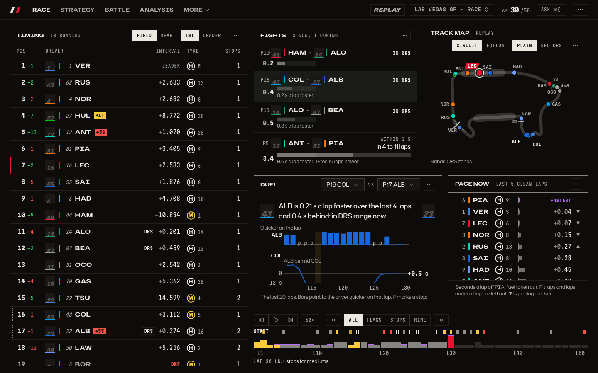

# Pitwall

A hub of Formula 1 knowledge: ask any question and get the answer with its proof, dig into deep
stats, and follow any session live or replay it later without spoilers.
Working name only; the product must not use "F1" or "Formula 1" in its brand.

**Status:** built and running on localhost; what is left waits on the owner's accounts and
decisions. See [what is built and what is next](docs/plans/README.md).



## Tour

Every screen in pictures, one page per area. [All of it, in one index](docs/tour/README.md).

| Area                                              | What it answers                                |
| ------------------------------------------------- | ---------------------------------------------- |
| [Live race](docs/tour/live.md)                    | What is happening on track right now           |
| [Replay](docs/tour/replay.md)                     | Any session since 2018, without spoilers       |
| [The race page](docs/tour/race-page.md)           | The map-first Race tab, the tabs, the timeline |
| [Watching a race closely](docs/tour/racewatch.md) | Who is racing whom, and who is faster          |
| [Ask](docs/tour/ask.md)                           | Plain-words questions, answered with proof     |
| [What you can ask](docs/tour/ask-kinds.md)        | Every kind of question, with its answer        |
| [History](docs/tour/history.md)                   | Seasons, standings and head to head            |
| [Drivers](docs/tour/drivers.md)                   | One driver up close, or against another        |
| [Dashboards](docs/tour/dashboards.md)             | Tiles you arrange, from a phone to a wall      |
| [Track](docs/tour/track.md)                       | Where everyone is, and who gains where         |
| [Strategy](docs/tour/strategy.md)                 | Tyres, stops, undercuts and true pace          |
| [Accounts and library](docs/tour/accounts.md)     | Sync, Pro, and publishing dashboards to fans   |

## How it works

One pipeline: a source emits events, one pure function folds them into the race, and sinks write
files and serve `WS /live`. Replay and live share it; a finished session has its result held back
until you choose to see it. [docs/architecture.md](docs/architecture.md) walks through it with four
diagrams: the whole system, one live message, replay and the spoiler rule, and the client.
How pace is worked out and asked: [docs/product/pace.md](docs/product/pace.md).

## Layout

| Workspace | What it is                                                                             |
| --------- | -------------------------------------------------------------------------------------- |
| `shared`  | Contracts shared by server and client: race data, the dashboard document, plans.       |
| `server`  | One Fastify process: the live feed, `WS /live`, saved sessions, and accounts (`/api`). |
| `client`  | React 19, Vite, Tailwind 4, shadcn/ui and shadcn charts (Recharts).                    |

## Getting started

Needs Node 22.18 or newer and, for the browser tests, a Playwright browser
(`npx playwright install chromium`; `openssl` for `npm run budgets`). Run the commands below in
separate terminals: the client serves on http://localhost:5173, the server on port 3000.

```sh
npm install

# Client on the mock replay (no server or database needed)
cp client/.env.example client/.env   # VITE_DATA_SOURCE=mock
npm run dev -w client

# Client on real data: set VITE_DATA_SOURCE=api in client/.env, then run the server below

# Server: live feed, WS /live and saved sessions on one port (3000); no database needed
cp server/.env.example server/.env   # optional
npm run dev -w server

# Accounts too: PGlite in data/accounts, sign-in links in the server log, fake payments.
# Vite sends /api to the server, so sign-in works on http://localhost:5173 with no account anywhere.
ACCOUNTS_DB=pglite npm run dev -w server

# With no session live, replay a saved one through the same live path
npm run fetch:f1 -w server -- 9858
npm run replay-live -w server -- --key 9858 --speed 10
```

The WebSocket protocol, the ingest/relay split for cloud hosts and the load smoke are in
[docs/product/live-protocol.md](docs/product/live-protocol.md).

The mock replay is the 2025 Las Vegas Grand Prix. Grid, stints, race control, weather, VSC laps
and the order at the flag are real (from `server/data-examples`); lap and sector times are
modelled and calibrated to the real gaps.

With `VITE_DATA_SOURCE=api` the client reads `catalog.json` and saved sessions from
`VITE_API_URL` and follows `WS /live` at `VITE_WS_URL`. The Session tile and ⌘K pick any
season, meeting and session (`?session=<key>` links to one); opening the app during a live
session goes to it. Live sessions can run behind the feed by a broadcast delay. How people move
through all of it, live, catching up and digging in: [docs/product/flows.md](docs/product/flows.md).

## Run the production build locally

```sh
docker compose up --build                 # http://localhost:8080
docker compose --profile replay up        # also replays a saved race through ingest -> relay
```

Postgres, the relay and accounts API, and the client as static files behind Caddy. Hosting it for
real, the CI workflow and the owner's checklist are in [docs/deploy.md](docs/deploy.md).

## Checks

One test file: run the runner directly, for example `node --test client/src/data/spoilers.test.ts`
(client, shared) or `node --import tsx --test server/src/live/session.test.ts` (server). The rules
a change must keep, the branch and commit style and what "done" means are in [AGENTS.md](AGENTS.md).

One e2e spec: `cd client && CI=1 npx playwright test --project=e2e <file>` for `client/e2e/*.spec.ts`, or
`-c playwright.real.config.ts --project=real` for `client/e2e/real/`. Unit tests need no build and no data.

| Command              | What it runs                                                                             |
| -------------------- | ---------------------------------------------------------------------------------------- |
| `npm run check`      | Typecheck (TypeScript 7), oxlint, Prettier and the link check.                           |
| `npm run lint`       | oxlint with the anti-slop and shadcn lint plugins.                                       |
| `npm run format`     | Prettier.                                                                                |
| `npm run test:unit`  | Node test runner in every workspace, and the docs check.                                 |
| `npm run test:e2e`   | Playwright: mock replay, production build, real data, live, archive and the local stack. |
| `npm run shots`      | Screenshots on the mock and on real data, dark/light.                                    |
| `npm run docs:shots` | Regenerates every picture in `docs/tour`.                                                |
| `npm run docs:links` | Broken link or missing image in README.md and `docs/`.                                   |
| `npm run budgets`    | Initial bundle size and Lighthouse CI, mobile and desktop.                               |

Shots land in `client/shots/output/<viewport>/<page>-<plan>-<theme>.png` and, on real data, in
`client/shots/output/real/` (not committed); they are meant for design and quality audits. The
real-data runs (`client/playwright.real.config.ts`) read a committed fixture of the 2025 Las Vegas
race and qualifying and 2026 Baku qualifying, derived by `client/e2e/real/derive-fixtures.ts`,
and replay a trimmed race through `replay-live`. A trimmed 2019 race (`client/e2e/archive`, derived by
its `derive-fixture.ts`) has its positions fetched from a stand-in archive. If Playwright's own browser
is not installed, point it at any Chromium with `PW_CHROMIUM_PATH=/path/to/chrome`.

Playwright starts its own servers on fixed ports: the apps on 4173 to 4179, the servers on 3111 to 3114. Worktrees that run e2e or shots side by side set `PW_PORT_BASE` to a different number in
each, for example `PW_PORT_BASE=4373 CI=1 npm run test:e2e`; it moves every one of those ports
(`client/playwright.ports.ts` lists them). Run with `CI=1`, so Playwright never reuses a server
that another run started.

Locally each suite runs two browser workers; `PW_WORKERS` changes it (GitHub Actions keeps
Playwright's default).

### Launch budgets

`npm run budgets` builds the mock replay with drawn pictures and serves it the way a static host
does (HTTP/2, Brotli; `client/scripts/serve-dist.ts`, which needs `openssl` for a throwaway
localhost certificate). The server takes a free port on 127.0.0.1, so a dev server another
checkout runs on a fixed port never answers in its place. It then checks:

- the first route's scripts and styles against `BUDGET` in `client/scripts/budgets.ts`, in gzip kB;
- Lighthouse on `/`, `/analysis` and `/library`, mobile and desktop: performance 90 or more,
  accessibility, best practices and SEO 95 or more, judged on the median of three runs
  (`client/lighthouserc.json`). Reports land in `client/.lighthouseci/`.

The local run is the strict one: every score is a hard limit, on a stable machine before a release.
On CI (a shared 2-core runner, where mobile performance scores 59-79 against 89-95 on a Mac) mobile
performance only warns; the other scores, desktop performance and the size budget still fail the
job, and the score table goes to the job summary.

`npm run test:e2e` also runs axe on every main route in both themes and fails on any serious or
critical violation (`client/e2e/accessibility.spec.ts`), and covers the production build's
manifest, offline shell and consent question (`client/e2e/build/`).

The brand (name, domain, support address, social links) lives in `client/src/brand.ts`, and the
legal text in `client/src/legal/content.ts`; `npm run brand-assets -w client` redraws the favicon,
install icons and share card after a change.

The anti-slop oxlint plugin is vendored in `tools/oxlint/anti-slop` (see `UPSTREAM.md`). shadcn
primitives live in `client/src/components/ui`; screens compose them through variants rather than
restyling them, which `@shadcn/lint` enforces.

## More

- [What the product does](docs/product/features.md), [dashboards and tiles](docs/product/dashboards.md), [flows](docs/product/flows.md), [history](docs/product/history.md), [telemetry](docs/product/telemetry.md) and the [live protocol](docs/product/live-protocol.md).
- Design rules: [docs/design/identity.md](docs/design/identity.md).
- What comes next: [docs/plans](docs/plans/README.md).
- Hosting, CI and the owner's checklist: [docs/deploy.md](docs/deploy.md).
