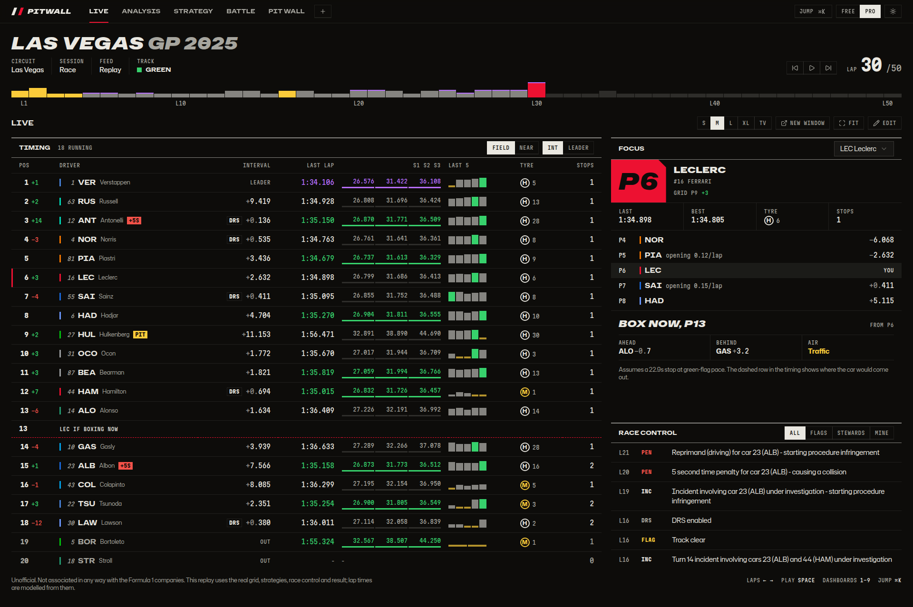
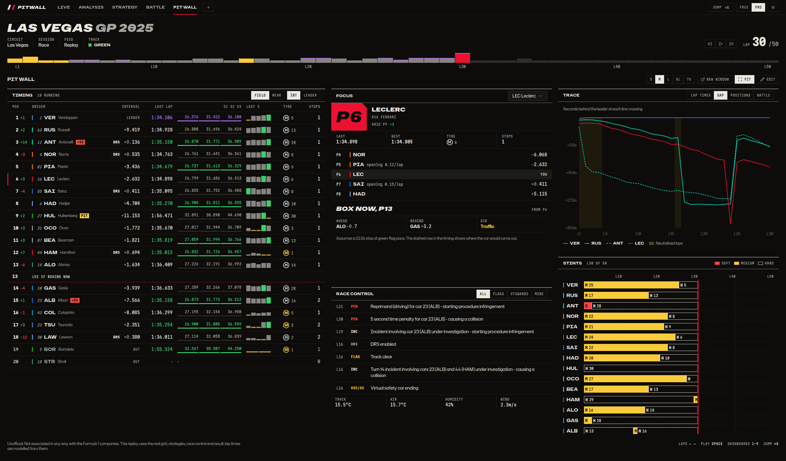
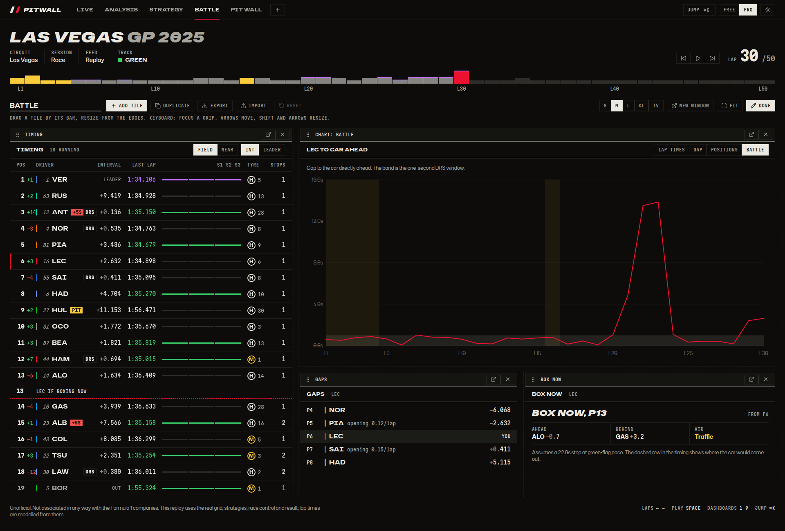
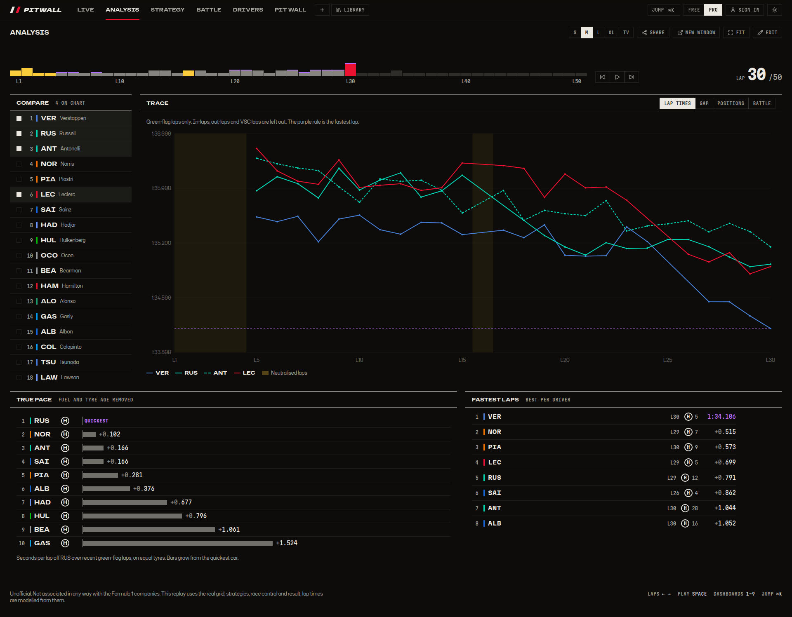
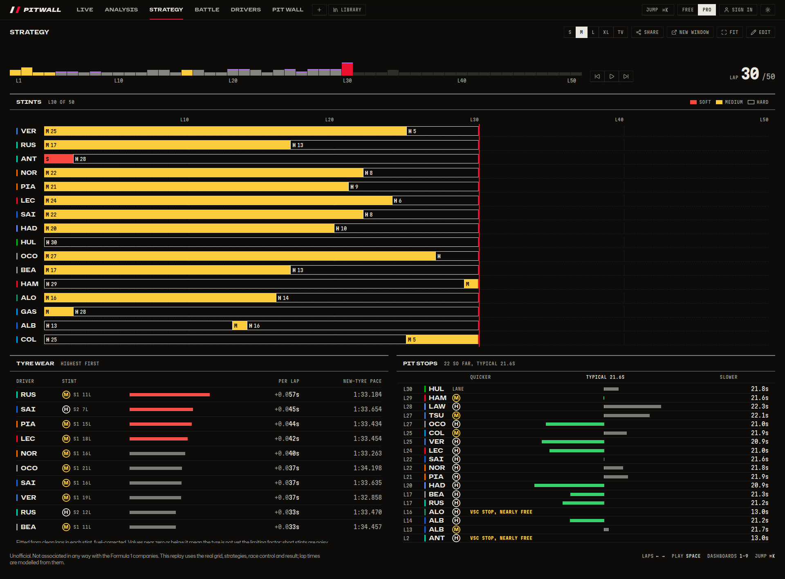
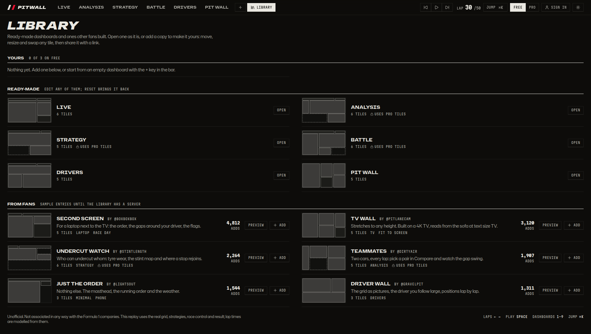
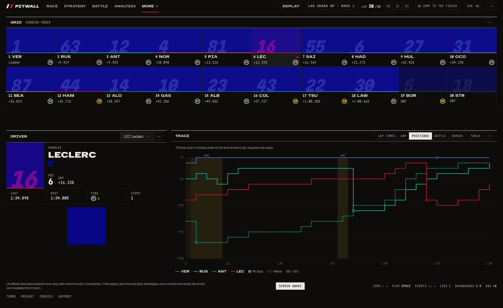

# Pitwall (f1-live)

Live and post-race Formula 1 insights: timing, battles, pit windows, tyre strategy and pace.
Working name only; the product must not use "F1" or "Formula 1" in its brand.



| Pit wall at 2560px, fit to screen                                                                  | Building a dashboard                                                                           |
| -------------------------------------------------------------------------------------------------- | ---------------------------------------------------------------------------------------------- |
|                          |                  |
| **Analysis**                                                                                       | **Strategy**                                                                                   |
|           |                  |
| **Library**                                                                                        | **Drivers**                                                                                    |
|  |  |

More screens (light theme, tablet, phones, edit mode): [docs/screenshots.md](docs/screenshots.md). The whole dashboard flow, step by step: [docs/flow.md](docs/flow.md).

## History

Seasons from 2018 on: a calendar with `.ics` export, standings after any round, driver pages and a
head to head for any two drivers or teams. See [docs/product/history.md](docs/product/history.md).

## Dashboards

The whole screen is tiles on a 24-column grid, from a phone to a wall monitor: the race title,
replay keys and lap strip move and resize like timing or a chart.

- **Session-aware.** `/` opens the layout for the session on screen: Race, Quali or Practice,
  named in the first tab. A live strip under the top bar says on every page whether a session is
  live, which part, the time left, the flag and who is in the drop zone, or what starts next.
- **One timeline.** The Replay tile plays at 1×, 10× and 60× real time, jumps between events
  (flags, stops, your driver's moments) with Shift and the arrows, and scrubs along the race
  barcode. Track maps move smoothly between laps.
- **No spoilers.** A finished session you have not seen opens at its start, paused, with Play
  and a separate Jump to the finish; nothing else on screen gives the result away. Watching to
  the end reveals it, on every device you are signed in on. Live stays live.
- **Drill down.** Click a driver anywhere (timing, the map, charts, knockout, race control) for
  their session in a side sheet: every lap with its sectors, tyres, gaps and rulings, qualifying
  runs, stints, best sectors and telemetry. Click a lap for its traces against anyone's lap, or
  compare two drivers. Each view has its own address; Back and Escape close it.
- **Ready-made.** The three session layouts, Analysis and Strategy (at `/analysis`,
  `/strategy`), Battle, Track, Drivers, Race story and Pit wall; the ones a session does not need
  wait under More. Edit any of them and Reset brings it back; **+** starts your own.
- **36 tiles in 6 groups.** Race (session, replay, lap strip, story, weather, race control),
  Drivers (focus, driver, grid), Timing (with knockout and best sectors), Track (track map,
  battle map, pit rejoin, mini-sector dominance, flag map, speed map, gap distance, ghost lap),
  Analysis (charts, telemetry traces, long runs, championship, conditions) and Strategy (stints,
  tyre wear, stops, undercut ledger, stop cost, pit crews). Tiles for another kind of session
  shrink to one line.
  Drag by the bar, resize from the edges, or use the keyboard: focus a grip, arrows move, Shift
  and arrows resize. Edit mode bars sit in
  the gaps, so a dashboard looks the same while you build it.
- **Maps.** Every car on the circuit, smooth at the display's refresh rate: from the replay's
  car positions, the live feed's positions channel, or estimated from timing when there are
  none.
- **Gaps as distance.** Qualifying or the race on one straight, each car behind by the metres
  its gap is worth; the best laps run together as a ghost lap; and a picture of it at social
  sizes to share.
- **Any monitor.** Panels lay out by their tile's width (container queries). **Fit** stretches
  rows to the window height; text size runs from S to TV; narrow screens stack tiles.
- **Windows.** Pop out a tile or a dashboard; lap, driver, plan, compared drivers and play/pause
  stay in sync.
- **Library and sharing.** `/library` has your dashboards, the ready-made ones and fan
  dashboards to preview and add. **Share** copies a link that carries the whole dashboard; no
  server needed. Export/Import does the same with a file.
- **First run.** `/welcome` picks the driver you follow and a starting dashboard.
- **Free and Pro.** Free keeps 3 dashboards of your own; Pro keeps any number, unlocks Pro tiles
  and publishing. Accounts are real: an emailed sign-in link (Google and Apple when set up),
  dashboards synced across devices, Pro through Stripe or a fake provider in development, and
  an account page to export or delete everything. The fan library is still mocked.
- **Pictures.** Driver photos, team logos and cars load from formula1.com in the viewer's browser,
  using the references the timing feed publishes; nothing is stored in the repo, and each has a
  drawn fallback. A paid launch needs a media licence first.

How it all fits together, what ships by default and the backend contract:
[docs/product/dashboards.md](docs/product/dashboards.md).

Design rules: [docs/design/identity.md](docs/design/identity.md). What comes next: [docs/plans](docs/plans/README.md).

## Layout

| Workspace | What it is                                                                             |
| --------- | -------------------------------------------------------------------------------------- |
| `shared`  | Contracts shared by server and client: race data, the dashboard document, plans.       |
| `server`  | One Fastify process: the live feed, `WS /live`, saved sessions, and accounts (`/api`). |
| `client`  | React 19, Vite, Tailwind 4, shadcn/ui and shadcn charts (Recharts).                    |

## Getting started

```sh
npm install

# Client on the mock replay (no server or database needed)
cp client/.env.example client/.env   # VITE_DATA_SOURCE=mock
npm run dev -w client

# Client on real data: set VITE_DATA_SOURCE=api in client/.env, then run the server below

# Server: live feed, WS /live and saved sessions on one port (3000); no database needed
cp server/.env.example server/.env   # optional
npm run dev -w server

# Accounts too: PGlite in data/accounts, sign-in links in the server log, fake payments.
# Vite sends /api to the server, so sign-in works on http://localhost:5173 with no account anywhere.
ACCOUNTS_DB=pglite npm run dev -w server

# With no session live, replay a saved one through the same live path
npm run fetch:f1 -w server -- 9858
npm run replay-live -w server -- --key 9858 --speed 10
```

The WebSocket protocol, the ingest/relay split for cloud hosts and the load smoke are in
[docs/product/live-protocol.md](docs/product/live-protocol.md).

The mock replay is the 2025 Las Vegas Grand Prix. Grid, stints, race control, weather, VSC laps
and the order at the flag are real (from `server/data-examples`); lap and sector times are
modelled and calibrated to the real gaps.

With `VITE_DATA_SOURCE=api` the client reads `catalog.json` and saved sessions from
`VITE_API_URL` and follows `WS /live` at `VITE_WS_URL`. The Session tile and ⌘K pick any
season, meeting and session (`?session=<key>` links to one); opening the app during a live
session goes to it. Live sessions can run behind the feed by a broadcast delay. How people move
through all of it, live, catching up and digging in: [docs/product/flows.md](docs/product/flows.md).

## Run the production build locally

```sh
docker compose up --build                 # http://localhost:8080
docker compose --profile replay up        # also replays a saved race through ingest -> relay
```

Postgres, the relay and accounts API, and the client as static files behind Caddy. Hosting it for
real, the CI workflow and the owner's checklist are in [docs/deploy.md](docs/deploy.md).

## Checks

| Command                       | What it runs                                               |
| ----------------------------- | ---------------------------------------------------------- |
| `npm run check`               | Typecheck (TypeScript 7), oxlint and Prettier.             |
| `npm run lint`                | oxlint with the anti-slop and shadcn lint plugins.         |
| `npm run format`              | Prettier.                                                  |
| `npm run test:unit -w client` | Node test runner over the mock race and insights.          |
| `npm run test:e2e`            | Playwright on the mock replay, then on real data and live. |
| `npm run shots`               | Screenshots on the mock and on real data, dark/light.      |
| `npm run budgets`             | Initial bundle size and Lighthouse CI, mobile and desktop. |

Shots land in `client/shots/output/<viewport>/<page>-<plan>-<theme>.png` and, on real data, in
`client/shots/output/real/` (not committed); they are meant for design and quality audits. The
real-data runs (`client/playwright.real.config.ts`) read a committed fixture of the 2025 Las Vegas
race and qualifying and 2026 Baku qualifying, derived by `client/e2e/real/derive-fixtures.ts`,
and replay a trimmed race through `replay-live`. If Playwright's own browser is not installed, point it at
any Chromium with `PW_CHROMIUM_PATH=/path/to/chrome`.

Playwright starts its own servers on fixed ports: the apps on 4173 to 4176, the servers on 3111, 3112
and 3114. Worktrees that run e2e or shots side by side set `PW_PORT_BASE` to a different number in
each, for example `PW_PORT_BASE=4373 CI=1 npm run test:e2e`; it moves every one of those ports
(`client/playwright.ports.ts` lists them). Run with `CI=1`, so Playwright never reuses a server
that another run started.

### Launch budgets

`npm run budgets` builds the mock replay with drawn pictures and serves it the way a static host
does (HTTP/2, Brotli; `client/scripts/serve-dist.ts`, which needs `openssl` for a throwaway
localhost certificate). The server takes a free port on 127.0.0.1, so a dev server another
checkout runs on a fixed port never answers in its place. It then checks:

- the first route's scripts and styles against `BUDGET` in `client/scripts/budgets.ts`, in gzip kB;
- Lighthouse on `/`, `/analysis` and `/library`, mobile and desktop: performance 90 or more,
  accessibility, best practices and SEO 95 or more, judged on the median of three runs
  (`client/lighthouserc.json`). Reports land in `client/.lighthouseci/`.

The local run is the strict one: every score is a hard limit, on a stable machine before a release.
On CI (a shared 2-core runner, where mobile performance scores 59-79 against 89-95 on a Mac) mobile
performance only warns; the other scores, desktop performance and the size budget still fail the
job, and the score table goes to the job summary.

`npm run test:e2e` also runs axe on every main route in both themes and fails on any serious or
critical violation (`client/e2e/accessibility.spec.ts`), and covers the production build's
manifest, offline shell and consent question (`client/e2e/build/`).

The brand (name, domain, support address, social links) lives in `client/src/brand.ts`, and the
legal text in `client/src/legal/content.ts`; `npm run brand-assets -w client` redraws the favicon,
install icons and share card after a change.

The anti-slop oxlint plugin is vendored in `tools/oxlint/anti-slop` (see `UPSTREAM.md`). shadcn
primitives live in `client/src/components/ui`; screens compose them through variants rather than
restyling them, which `@shadcn/lint` enforces.

### ROADMAP

- ⌛ - in progress
- ✅ - done
- 🔜 - coming soon

| Feature          | Progress                            | Status         |
| ---------------- | ----------------------------------- | -------------- |
| WebSocket        |  | ⌛ In Progress |
| Sector Colors    |    | 🔜 Coming soon |
| REST Historical  |  | ⌛ In Progress |
| Position Changes |    | 🔜 Coming soon |
| Segments         |    | 🔜 Coming soon |
| Pit-stops        |    | 🔜 Coming soon |
| Deltas           |    | 🔜 Coming soon |
| Incidents        |    | 🔜 Coming soon |
| Weather          |    | 🔜 Coming soon |

### OLD ROADMAP

- [ ] ws connection with the world (highest)
- [ ] start working with sector colors and best laps (highest)
- [ ] REST to get historical data (mid)
- [ ] start working with drivers position changes in sprint/race (mid)
- [ ] start working with segments (mid)
- [ ] start working with pit-stops (mid)
- [ ] start working with deltas (low)
- [ ] analyze how to work with incidents (low)
- [ ] start work with weather (low)
