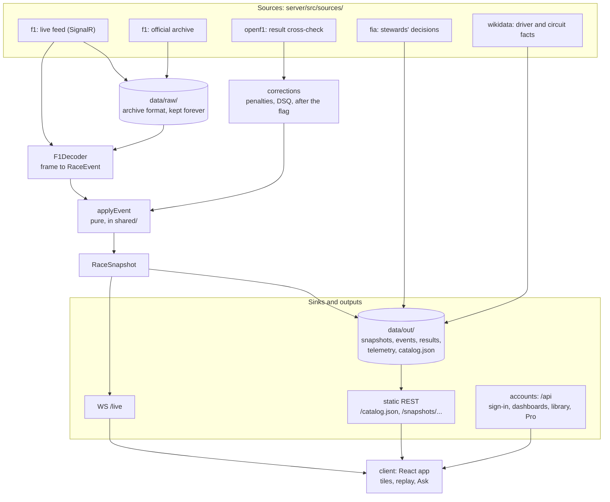
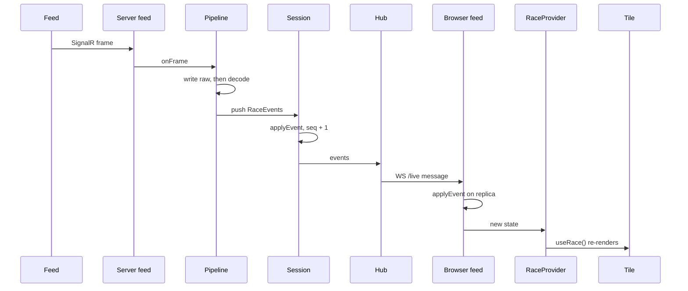
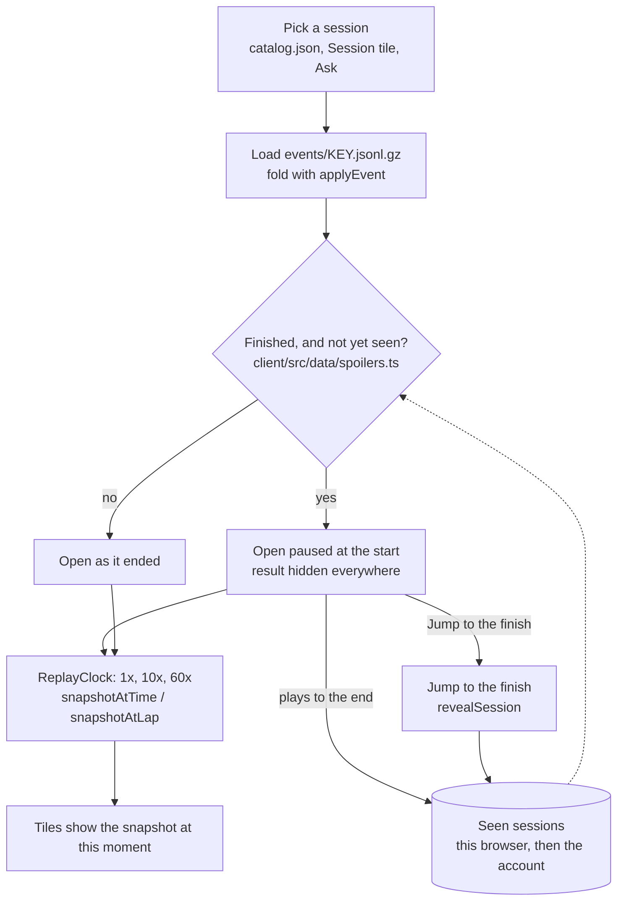
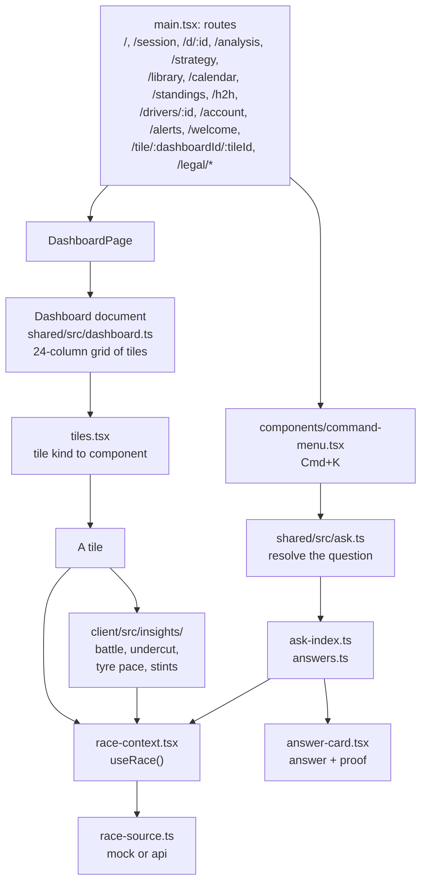

# How Pitwall works

A walkthrough for a new contributor. Every file named here exists; each step names the test that
covers it, or the end-to-end spec where only that exercises it. For what each screen does, see the [tour](tour/README.md); for the rules a change must
keep, see [AGENTS.md](../AGENTS.md).

One idea runs through everything: **every source becomes the same stream of `RaceEvent`s, one pure
function folds events into a `RaceSnapshot`, and everything else (live, replay, history, Ask) is a
reader of events or snapshots.** Raw input is kept forever; anything else can be rebuilt from it.

- [1. The whole system](#1-the-whole-system)
- [2. One live message, from the feed to a tile](#2-one-live-message-from-the-feed-to-a-tile)
- [3. Replay and the spoiler rule](#3-replay-and-the-spoiler-rule)
- [4. The client: routes, dashboards, tiles, insights, Ask](#4-the-client-routes-dashboards-tiles-insights-ask)
- [Where to change what](#where-to-change-what)
- [Data directory, rebuild, corrections](#data-directory-rebuild-corrections)
- [Budgets and CI](#budgets-and-ci)

## 1. The whole system

1. **Sources** each speak their own format and stop at the boundary: they are parsed with zod and
   turned into `RaceEvent`s. The live feed is `server/src/sources/f1/live.ts`; the official
   archive is read by `server/src/sources/f1/archive.ts`, which reads the same line format the
   recorder writes. Tests: `server/src/sources/f1/live.test.ts`,
   `server/src/sources/f1/archive.test.ts`.
2. **Raw is the master copy.** The recorder, `server/src/sources/f1/raw-writer.ts`, writes live
   frames into `data/raw/` in the archive's own layout, so a recorded live session and a
   downloaded archive session are the same thing to every later step. Test:
   `server/src/sources/f1/raw-writer.test.ts`.
3. **One decoder.** `server/src/sources/f1/decode.ts` (`F1Decoder`) turns a topic frame into
   `RaceEvent[]`, whether the frame came live or from a file. Test:
   `server/src/sources/f1/decode.test.ts`.
4. **One pure reducer.** `applyEvent(state, event)` in `shared/src/apply-event.ts` folds events into
   a `RaceSnapshot` (`shared/src/race.ts`); the event types are in `shared/src/events.ts`. The
   server and the browser run the same function. Test: `shared/src/apply-event.test.ts`.
5. **Corrections** (a disqualification, a time penalty after the flag) are events too, and they
   skip the decoder. Three sources are merged by `server/src/import/corrections.ts`: unserved
   penalties read from the feed (`server/src/sources/f1/unserved-penalties.ts`), the OpenF1 result
   cross-check (`server/src/sources/openf1/session-result.ts`) and hand-written files in
   `server/corrections/`. The list is in `server/src/import/ingest.ts`. Test: `server/src/import/corrections.test.ts`.
6. **Import** (`server/src/import/ingest.ts`) reads a raw session, decodes it, applies
   corrections, folds it and writes the sinks: events, snapshot, results and telemetry. The
   catalog (`server/src/catalog/catalog.ts`) is rebuilt from the season indexes by
   `server/src/import/run.ts`. Test: `server/src/import/ingest.test.ts`.
7. **Side data.** The FIA documents (`server/src/sources/fia/`) become stewards' decisions and
   Wikidata (`server/src/sources/wikidata/`) becomes driver and circuit facts; both land in
   `data/out/` and feed Ask's proofs. Tests: `server/src/sources/fia/build.test.ts`,
   `server/src/sources/wikidata/entity.test.ts`.
8. **Serving.** `server/src/http/static-data.ts` serves `data/out/` read-only;
   `server/src/http/live-socket.ts` serves `WS /live`. `MODE` (`server/src/config.ts`, branched in `server/src/main.ts`): in `ingest` the server only
   reads the feed and pushes to a relay (`server/src/live/relay.ts`); in `relay` it only serves.
   Tests: `server/src/http/http.test.ts` (static data), `server/src/live/relay.test.ts`.
9. **Accounts** (`server/src/accounts/`) are separate from race data: sign-in, synced dashboards,
   the fan library, alerts and Pro through a payment provider (a fake one in development).
   Postgres or PGlite holds them; race data never touches a database. Tests:
   `server/src/accounts/routes.test.ts`, `server/src/accounts/library/library.test.ts`.
10. **The client** picks a data source with `VITE_DATA_SOURCE` (`mock` or `api`) in
    `client/src/data/race-source.ts`, so the whole UI runs without a server. The mock is a
    simulated race (`client/src/data/mock/simulate-race.ts`, tested beside it); the real path is
    covered by `client/e2e/real/saved.spec.ts`.

## 2. One live message, from the feed to a tile

1. **Receive.** `LiveFeed` in `server/src/sources/f1/live.ts` holds the SignalR connection:
   negotiate, subscribe, reconnect with backoff, a stall timeout. Test:
   `server/src/sources/f1/live.test.ts`.
2. **Record, then decode.** `LivePipeline.onFrame` in `server/src/live/pipeline.ts` first writes
   the frame to `data/raw` and only then decodes it, so a decoder bug never loses data. `server/src/main.ts`
   also hands position and car data frames to `server/src/telemetry/live.ts`. Tests:
   `server/src/sources/f1/raw-writer.test.ts` (the recorder) and
   `server/src/live/importer.test.ts` (what was recorded imports like an archive session).
3. **Fold.** `LiveSession.push` in `server/src/live/session.ts` runs `applyEvent`, bumps the
   sequence number, keeps the event log and tells its listeners. A viewer that reconnects asks
   for events `since` a number and gets only the gap. Test: `server/src/live/session.test.ts`.
4. **Fan out.** `LiveHub` in `server/src/live/hub.ts` batches the updates of one tick into one
   message per viewer; the wire format is `server/src/live/protocol.ts`. Test:
   `server/src/live/live-server.test.ts` (viewers, resume and epoch through a real socket).
5. **Replicate in the browser.** `client/src/data/live-feed.ts` parses the message and folds the
   same events into its own copy of the snapshot with the same `applyEvent`; a gap or a new epoch
   asks for a resync. Test: `client/src/data/live-feed.test.ts`.
6. **Show.** `RaceProvider` in `client/src/data/race-context.tsx` turns the replica into what is
   on screen (applying the broadcast delay and the spoiler rule) and tiles read it with
   `useRace()`. `TimingTower` in `client/src/features/live/timing-tower.tsx` is one. Test:
   `client/e2e/live/live.spec.ts` replays a trimmed race through the whole chain with
   `server/src/cli/replay-live.ts`.
7. **When the session ends**, `LivePipeline` notices the finished status and
   `server/src/live/importer.ts` runs the normal import on what the recorder wrote, so the
   session joins the catalog like any archive one. Test: `server/src/live/importer.test.ts`.

The message formats, resume rules and the load smoke are in
[docs/product/live-protocol.md](product/live-protocol.md).

## 3. Replay and the spoiler rule

1. **Pick.** The catalog lists every session by its archive key (9858 is the 2025 Las Vegas race).
   `?session=<key>` links to one. Test: `client/e2e/real/saved.spec.ts`.
2. **Load.** In `api` mode the client fetches the session's event file and folds it with
   `applyEvent`, the same function the server used. Test: `client/e2e/real/saved.spec.ts`.
3. **Decide.** `client/src/data/spoilers.ts` is the one place that says whether a result may show;
   every list, answer and table that could leak a result asks it. The viewer's "seen" list lives
   in `client/src/data/viewer-settings.ts` and follows the account across devices. Tests:
   `client/src/data/spoilers.test.ts`, `shared/src/viewer.test.ts`.
4. **Start paused.** `client/src/features/session/spoiler-start.tsx` is the banner with Play and a
   separate "Jump to the finish". `useVisibleRace()` in `client/src/data/race-context.tsx` returns
   the snapshot at the replay position while the result is held, the whole session otherwise. Test: `client/e2e/real/saved.spec.ts`.
5. **Play.** `client/src/data/replay-clock.ts` runs at 1×, 10× and 60×;
   `client/src/data/session-time.ts` finds the next event for the jump keys;
   `client/src/data/snapshot-at-time.ts` rebuilds the snapshot at any moment and replays
   corrections only once their time has come. Tests: `client/src/data/session-time.test.ts` (the
   jump keys) and `client/src/insights/session-clock.test.ts` (the snapshot at a moment).
6. **Reveal.** Watching to the end, or Jump to the finish, adds the session to the seen list.
   Live stays live: the rule never hides a session in progress. Test:
   `client/e2e/navigation.spec.ts`.

How people move through live, catch-up and digging in:
[docs/product/flows.md](product/flows.md).

## 4. The client: routes, dashboards, tiles, insights, Ask

1. **Routes** are all in `client/src/main.tsx`; titles are in `client/src/platform/route-meta.ts`.
   `/session`, `/analysis`, `/strategy` and `/d/:id` all render `DashboardPage`
   (`client/src/features/dashboard/dashboard-page.tsx`) with a different dashboard. Test:
   `client/e2e/navigation.spec.ts`.
2. **A dashboard is data.** `shared/src/dashboard.ts` defines the document (tiles with a kind and
   a place on a 24-column grid) and its zod schema, so a shared link, an exported file and an
   account copy are the same thing. The ready-made ones and the per-session layouts are in
   `client/src/features/dashboard/dashboards.ts` and `session-layouts.ts`. Tests:
   `client/src/features/dashboard/dashboards.test.ts`,
   `client/src/features/dashboard/session-layouts.test.ts`.
3. **A tile is a component picked by kind** in `client/src/features/dashboard/tiles.tsx`; heavy
   ones load lazily. Tiles read the race themselves through `useRace()` rather than receiving
   props, which is what lets any tile sit in any dashboard. The grid and edit mode are in
   `client/src/features/dashboard/dashboard-grid.tsx`. Test: `client/e2e/dashboards.spec.ts`.
4. **Insights are pure functions of the snapshot** in `client/src/insights/`: battles
   (`battle.ts`), the undercut ledger (`undercut.ts`), true pace (`tyre-pace.ts`) and stints and
   tyre life (`tyre-life.ts`, `long-runs.ts`). Tiles only draw them. Tests:
   `client/src/insights/insights.test.ts`, `client/src/insights/undercut.test.ts`,
   `client/src/insights/tyre-life.test.ts`.
5. **Ask** is a parser plus an index. `shared/src/ask.ts` resolves a question into a query;
   `client/src/features/ask/ask-index.ts` lists drivers, circuits, seasons and pages;
   `client/src/features/ask/answers.ts` answers a query from the results index, and
   `steward-answers.ts` from the FIA decisions. Each answer carries its proof, the source it came
   from (`proof` on the `Answer` type in `client/src/features/ask/answers.ts`, drawn by `answer-card.tsx`). Held results go through the
   spoiler rule like everything else. Tests: `shared/src/ask.test.ts`,
   `client/src/features/ask/answers.test.ts`, `client/e2e/real/ask.spec.ts`.
6. **History** (calendar, standings, head to head, driver pages) reads the season results the
   import writes (`server/src/results/season.ts`) through `client/src/features/history/`. Test:
   `client/e2e/real/history.spec.ts`; the product rules are in
   [docs/product/history.md](product/history.md).

## Where to change what

- **A new tile:** a component in `client/src/features/<area>/`, a kind in `shared/src/dashboard.ts`,
  an entry in `client/src/features/dashboard/tiles.tsx`; it reads the race with `useRace()`.
- **A new insight:** a pure function in `client/src/insights/` with a unit test; a tile draws it.
- **A new Ask question:** a rule in `shared/src/ask.ts` and an answer in
  `client/src/features/ask/answers.ts`, with its proof.
- **A new source (another feed or archive):** a folder in `server/src/sources/<provider>/` that
  emits `RaceEvent`s, parsed with zod at the boundary; nothing else changes.
- Which diagram to read: the whole system for the shape, the live message if you touch
  `server/src/live/`, replay if you touch time or spoilers, the client for screens.

Terms: **SignalR** is the live feed's wire protocol; a **topic frame** is one named message in
it (timing, positions, race control); a **tick** is one batching interval of the hub; a **plan** is
Free or Pro; **ingest** is the process that holds the feed and writes the data directory, **relay** serves
`WS /live` and saved sessions from it (cloud hosts split them; the default `MODE=all` runs both in
one process); **epoch** and **seq** number a session's event log so a viewer that missed some
events asks for exactly the gap; **replica** is the browser's own copy of the snapshot.

## Data directory, rebuild, corrections

`DATA_DIR` (default `data/`, never committed) holds everything the server reads and writes:

- `raw/<archive path>/`: `<Topic>.jsonStream` in the archive's own format, live or downloaded. This is the master copy; nothing rebuilds it.
- `out/snapshots/`: One `<key>.json.gz` per session. Rebuilt from raw.
- `out/events/`: One `<key>.jsonl.gz` of `RaceEvent`s per session (what replay folds). Rebuilt from raw.
- `out/results/`: One `<season>.json.gz` of results, for history and Ask. Rebuilt from raw.
- `out/telemetry/`: Car data, positions and lap traces per session; circuit outlines. Rebuilt from raw.
- `out/catalog.json`: Every season, meeting and session, with its key. Rebuilt from raw.
- `out/facts.json`: Wikidata facts; `out/decisions/` holds the FIA decisions. Rebuilt from their caches.
- `cache/`, `accounts/`: On-demand telemetry downloads; PGlite accounts in development. Not race data.

Paths are defined in `server/src/sinks/files.ts` and `server/src/telemetry/files.ts`. Sessions
before 2025 have no position or car data in the archive; opening one fetches its streams once
into `cache/` and builds its telemetry ([docs/product/telemetry.md](product/telemetry.md)).

**Rebuild.** `npm run rebuild -w server` (`server/src/cli/rebuild.ts`) regenerates all of `out/`
from `raw/` with no network and prints a digest of each output, so a rebuild that changes
nothing is visible as such. `npm run import -w server` and `npm run fetch:f1 -w server -- <key>`
bring in new sessions.

**Corrections.** A wrong official result is fixed with a file in `server/corrections/` that cites
its FIA document, never by editing raw data; `npm run rebuild -w server` applies it
(`server/corrections/README.md`). On the client, `snapshotAtTime` applies a correction only from
the moment it was decided, so a replay does not know the penalty before the stewards did.

## Budgets and CI

- **Budgets.** `npm run budgets` builds the mock replay, serves it as a static host would, caps the
  first route at 310 kB of scripts and 16 kB of styles (gzip) and needs Lighthouse mobile 0.9 or
  better. New features load after the first route. Raise a cap only on purpose, in
  `client/scripts/budgets.ts`. Details in the [README](../README.md#launch-budgets).
- **CI.** `.github/workflows/ci.yml` runs `npm run check` and the unit tests, the Playwright suites
  (mock, real data, live, archive, production build), the two Docker images, a production-like
  stack and the budgets. No job holds a secret or deploys; hosting is in
  [docs/deploy.md](deploy.md).
- **Docs.** `npm run docs:links` (part of `npm run check`) fails on a broken link or a missing
  picture in the README and `docs/`; `npm run docs:shots` redraws every picture in
  [docs/tour](tour/README.md).
