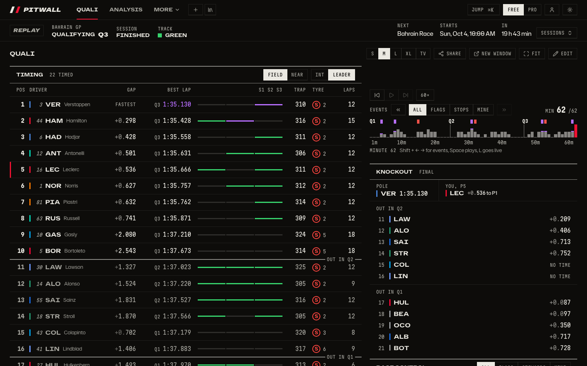
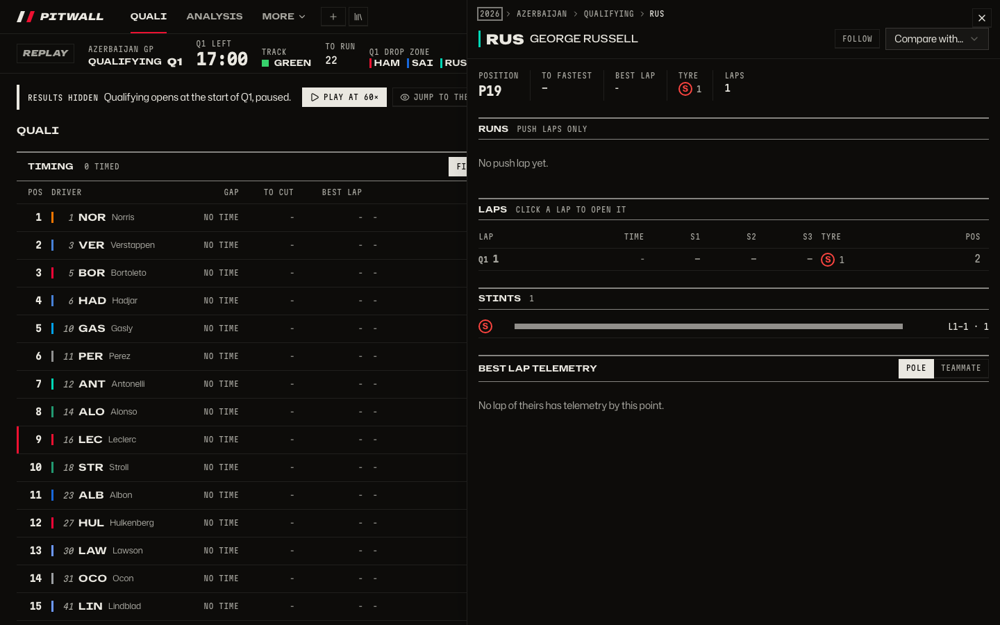
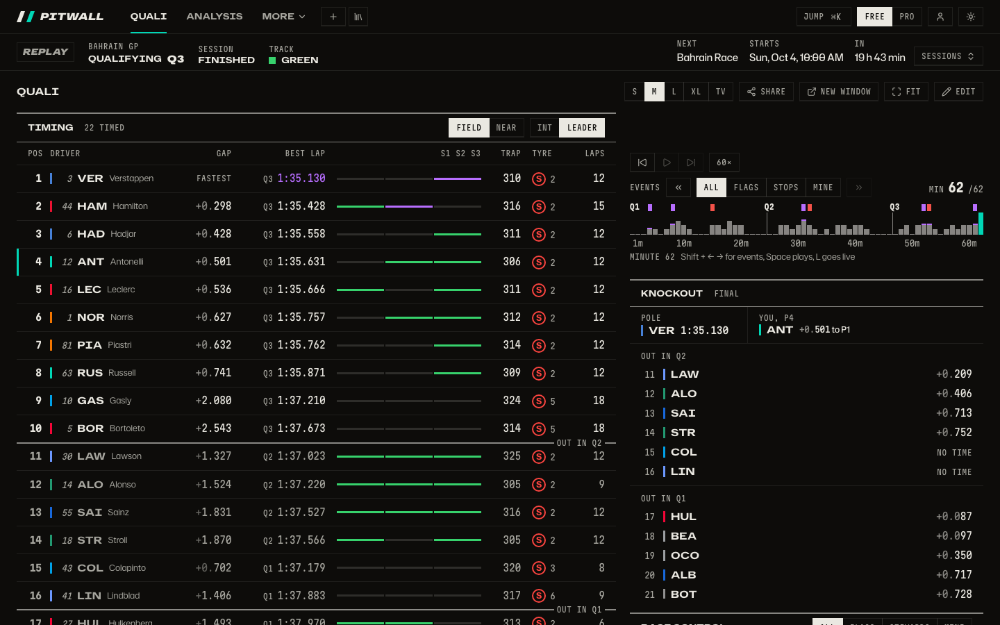
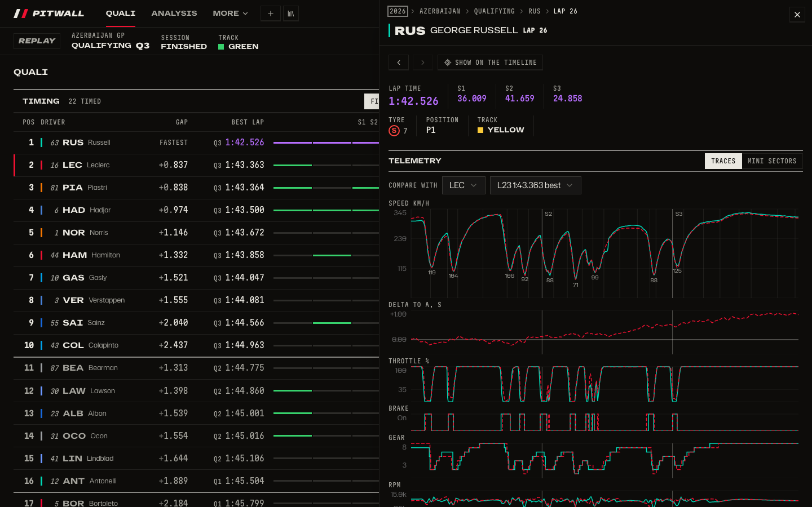
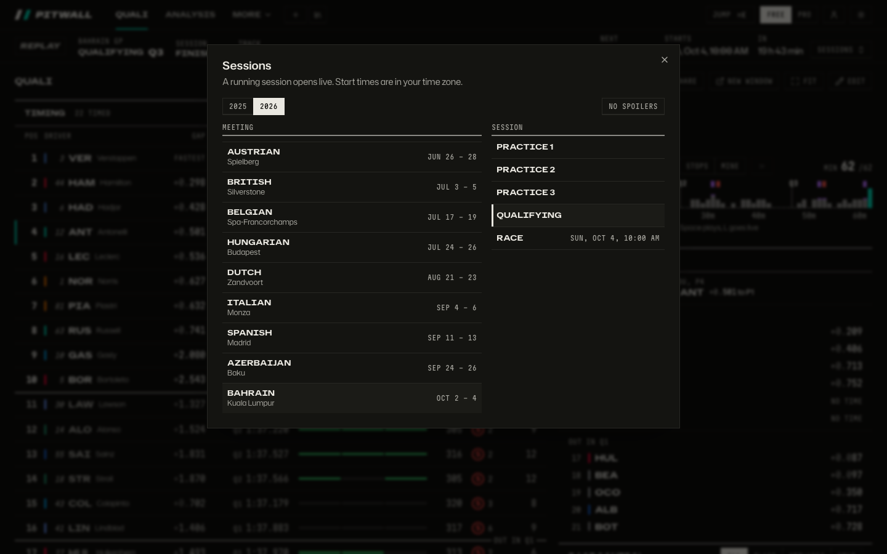
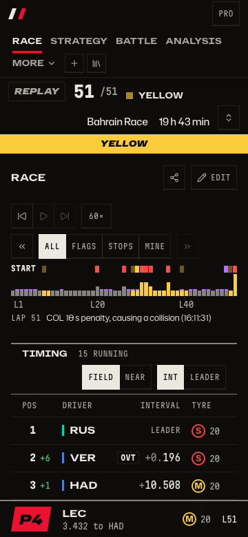

# User flows

How people move through Pitwall: live during a session, catching up later without spoilers,
digging into one driver or lap, browsing history, and arriving from a link. Each flow has its
entry point, the steps, what the screen shows and the ways out, then the friction found when it was
walked on real data (2026 Bahrain and Baku, 2025 Las Vegas) and what fixes it.

The rules the flows share:

- **Spoiler protection** is on by default. A finished session the viewer has not revealed opens at
  its start, paused, and nothing outside the replay position shows its result. One helper decides
  it, `client/src/data/spoilers.ts`; every screen that lists sessions or results uses it (see
  [Spoilers](#spoilers)).
- **Everything visible acts.** A driver anywhere opens that driver's session; a lap opens the lap;
  a moment (a chart point, a race-control message, an event marker) moves the replay there.
- **Every view has an address.** Session, replay position, driver and lap views are in the URL, so
  Back closes what was opened, and any view can be shared.

## A. Live during a session

**Entry.** Open the app while a session runs and pick Watch live on the home page (`/`), open
`/session`, or Watch live on the live strip from any other session.

**Steps.**

1. The screen goes to the running session and its layout (Race, Quali or Practice). The live strip
   is lit "Live" with the part, the time left or the lap, the flag and the drop zone.
2. Follow a driver: the Focus tile's picker, ⌘K, or Follow in their driver view. The app tints to
   their team and the pit board on phones shows them.
3. Something happens (a flag, a lap deleted, a stop): the flag banner wipes in, the story and race
   control list it. Click the message: the replay moves to that moment, and "Back to live" (or L)
   returns.
4. Click the driver it names: their session opens in a side sheet with the laps so far.

**Exits.** Back to live; another dashboard (1 to 9); the session ends and the screen stays on it,
revealed, because the viewer watched it.

**Joining late.** A viewer who opens a running session halfway gets "From the start" next to the
live state, to watch it from the beginning and catch up at 10× or 60×.

| Friction found                                                                          | Fix                                                                    |
| --------------------------------------------------------------------------------------- | ---------------------------------------------------------------------- |
| Clicking a timing row only re-tints the app; there is nothing deeper behind a driver.   | A row opens the driver's session view; Follow is a key in it.          |
| Race-control messages are read-only; seeing an incident again means scrubbing by guess. | Each message is a key that moves the replay to its moment.             |
| A late joiner has no way to start from the beginning except dragging the barcode to L1. | "From the start" on the live strip while live.                         |
| Spoiler-free mode (when on) opened a running session at lap 1 instead of live.          | Live stays live; only finished, unrevealed sessions open at the start. |

## B. Catch-up later without spoilers

The main new flow: I missed qualifying, I open it in the evening and watch it at 1× or faster,
skipping the quiet parts.

**Entry.** The home page (`/`), the session picker or ⌘K, or a link without a position.

**Steps.**

1. The session opens at its start: qualifying at the start of Q1, a race at lap 1, practice at its
   start. It is paused. A start card says results are hidden and offers **Play** and, apart from
   it, **Jump to the finish (shows results)**.
2. Play at 10× or 60×; Shift and the arrows skip to the next event (part starts, flags, deleted
   laps, improvements). The barcode and event markers show only what has happened so far.
3. Tiles show the session as it stood at the replay position: no pole in the knockout tile before
   Q3 ends, no winner in the strip before the flag.
4. Reaching the end reveals the session. So does Jump to the finish. Either way it is remembered
   on this device and, signed in, on the account.

**Exits.** The deep dive (flow C), another session of the weekend (flow D).

| Friction found                                                                                        | Fix                                                                                        |
| ----------------------------------------------------------------------------------------------------- | ------------------------------------------------------------------------------------------ |
| A saved session opens at its end: Bahrain qualifying opens at MIN 62/62, Q3, pole and the knockout.   | Spoiler protection on by default; unrevealed sessions open at the start, paused.           |
| Spoiler-free was a switch inside the session picker, off by default; nobody would find it first.      | On by default; one switch in the picker and in ⌘K ("Spoiler protection").                  |
| "Show results" was the only way out, and there was no clear Play at the start.                        | A start card with Play and Jump to the finish; the strip keeps Jump to the finish.         |
| Watching to the flag did not count as seeing the result, so the next visit opened at the start again. | Reaching the end reveals the session.                                                      |
| Reveals stayed on one browser.                                                                        | Signed in, reveals and the switch sync with the account.                                   |
| The page title and the picker gave no sign whether a session's results were hidden.                   | "Results hidden" in the picker with a per-session Show results; the title names no result. |

## C. Deep dive after watching

**Entry.** A driver anywhere: a timing row, a car on the track map, a chart line or legend, a
knockout row, the Focus tile, the battle map, a driver named in race control.

**Steps.**

1. The driver's session opens in a side sheet (a full page on phones), with its own address
   (`?car=63`). Headline: position, gap, best lap, tyre, stops.
2. Lap by lap: time, sectors coloured purple or green, tyre and age, position, gap and interval,
   pit in and out, flags, penalties and deleted laps. Under it: stints, position over the session,
   best sectors and the ideal lap, speed traps, their race-control messages and radio, and in
   qualifying each run of each part with its push laps.
3. Their best lap's telemetry against pole or their teammate.
4. Click a lap: the lap view (`&carLap=12`) with its sectors and mini sectors, the speed, throttle,
   brake and gear traces, and "Compare with" another driver's lap.
5. "Compare with…" from the driver view: two drivers side by side (`&vs=1`).

**Exits.** Back (or Esc) closes one level at a time; the breadcrumbs Season › Event › Session ›
Driver › Lap go to any level; "Show on timeline" moves the replay to a lap.

The views show the session up to the replay position while its results are hidden, and the whole
session once it is revealed.

| Friction found                                                                                      | Fix                                                                       |
| --------------------------------------------------------------------------------------------------- | ------------------------------------------------------------------------- |
| No view of one driver's session: their laps, runs, stints and messages are spread over six tiles.   | The driver view gathers them.                                             |
| A lap can be read only in the telemetry tile's pickers, three steps away from where it was seen.    | Any lap opens its lap view.                                               |
| Nothing shows two drivers side by side except charts of the compared set.                           | Compare from the driver view.                                             |
| Chart points, stint bars and race-control messages do not react to clicks, so nothing reads as one. | Points and messages move the replay; stint bars open the driver's stints. |

## D. Browse history

**Entry.** Sessions on the live strip, ⌘K ("Baku qualifying"), or the breadcrumbs' Season and
Event in any driver or lap view.

**Steps.**

1. The picker lists the season's meetings, then the weekend's sessions with their local start
   times. Unrevealed sessions say "Results hidden", with a Show results key beside them.
2. Pick a session: it opens with the spoiler rule, in its own layout.
3. A driver across a weekend: open the driver, then the next session from the picker; the driver
   view stays open on the same car (`car` is kept in the address).

**Exits.** Any session; the calendar, standings, driver pages and head to head are described in
[history.md](history.md) and use the same spoiler helper (30 day window).

| Friction found                                                                   | Fix                                                                     |
| -------------------------------------------------------------------------------- | ----------------------------------------------------------------------- |
| The picker gives no sign of which sessions were watched.                         | "Results hidden" marks the unrevealed ones; revealed ones read plainly. |
| Following one driver through a weekend means finding them again in each session. | The driver view's `car` stays in the address across sessions.           |
| Season and meeting are only reachable from the strip's Sessions key.             | The breadcrumbs open the picker on that season or meeting.              |

## E. First visit from a shared link or search

**Entry.** A link someone shared (`/?session=11373&lap=…` or `…&car=63`), or a search result.

**Steps.**

1. A link with a position (`lap`) opens there, as the sharer saw it: they chose to show it.
2. A link without one follows the spoiler rule: an unrevealed session opens at its start.
3. A link with a driver or lap view opens the session with the sheet over it; closing it leaves the
   viewer on the session, so Back does not leave the app.
4. `/welcome` stays one step away (the banner on the ready-made dashboards) to pick a driver.

**Exits.** Same as flows B and C.

| Friction found                                                                           | Fix                                                                          |
| ---------------------------------------------------------------------------------------- | ---------------------------------------------------------------------------- |
| A link without a position opened a finished session at its end.                          | The spoiler rule applies to links too; a position in the link still wins.    |
| A tab with a driver or lap open read like any other page of the app.                     | The title and share card name the open view and its session, never a result. |
| On a 360 px phone the row is the only target and there is no way to see a driver's laps. | The driver view is a full page on phones, with Back and a close key.         |

## Spoilers

One rule, in `client/src/data/spoilers.ts`:

- `isRevealed(settings, key)`: protection is off, or the viewer revealed the session.
- `resultsHidden(...)`: the session is finished or saved, not live, and not revealed.
- `spoilerSafeStep(...)`: where a session opens: the position in the link, else the start when
  hidden, else the end (or live).

Every place that lists sessions or results (the picker, ⌘K, the live strip, the page title, and
T11a's calendar, standings and library) asks these; a list of sessions uses `useIsRevealed()` and
`revealSession(key)` from `client/src/data/viewer-settings.ts`. Reveals are kept for the newest
200 sessions on the device and, signed in, on the account: `PUT /api/me/viewer` sends the device's
settings and answers the account's, merged (every reveal from either side; the newer change of the
switch wins).
