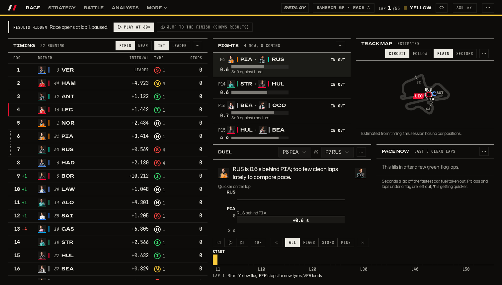
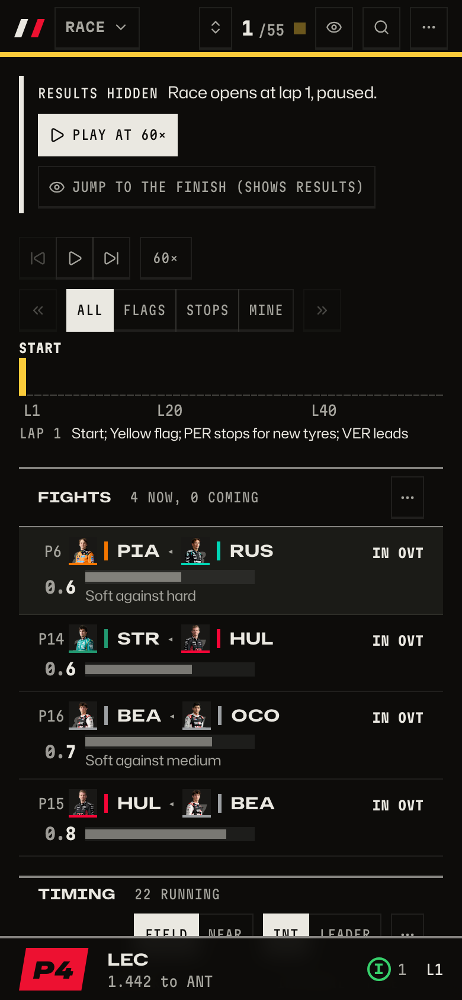
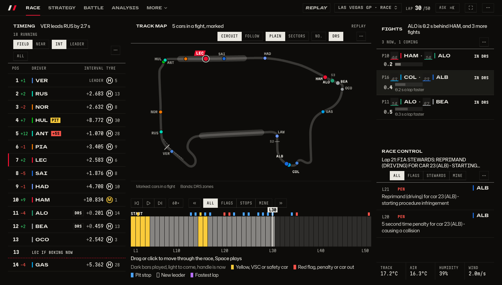
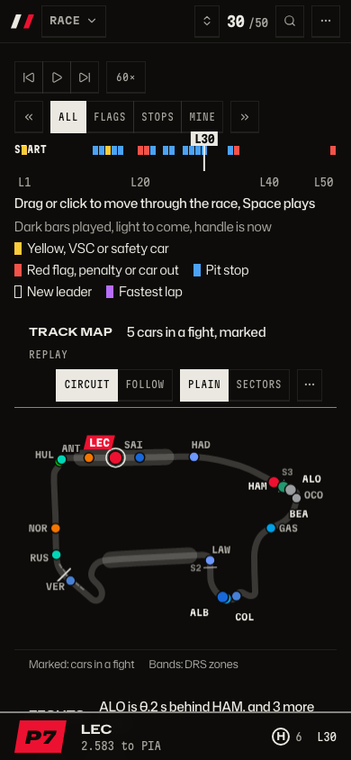
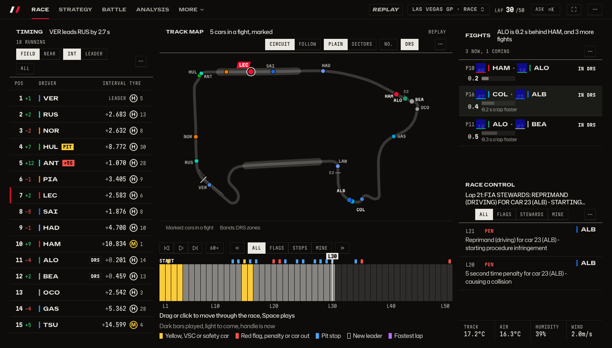
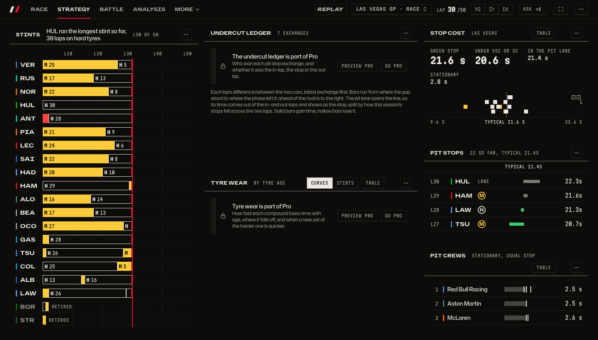
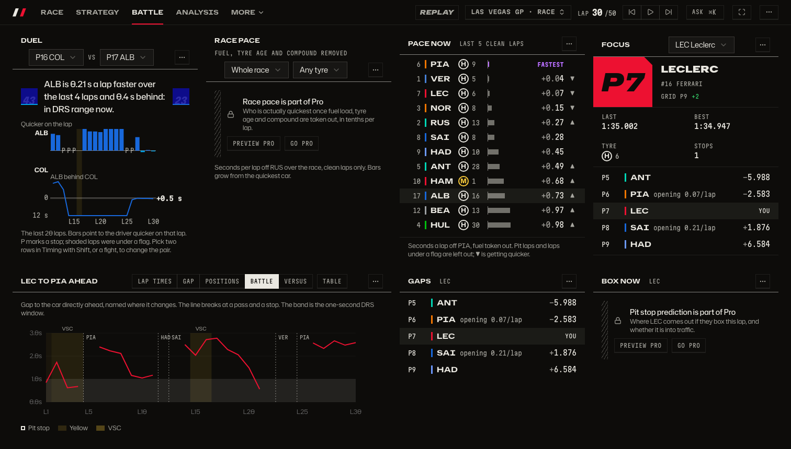
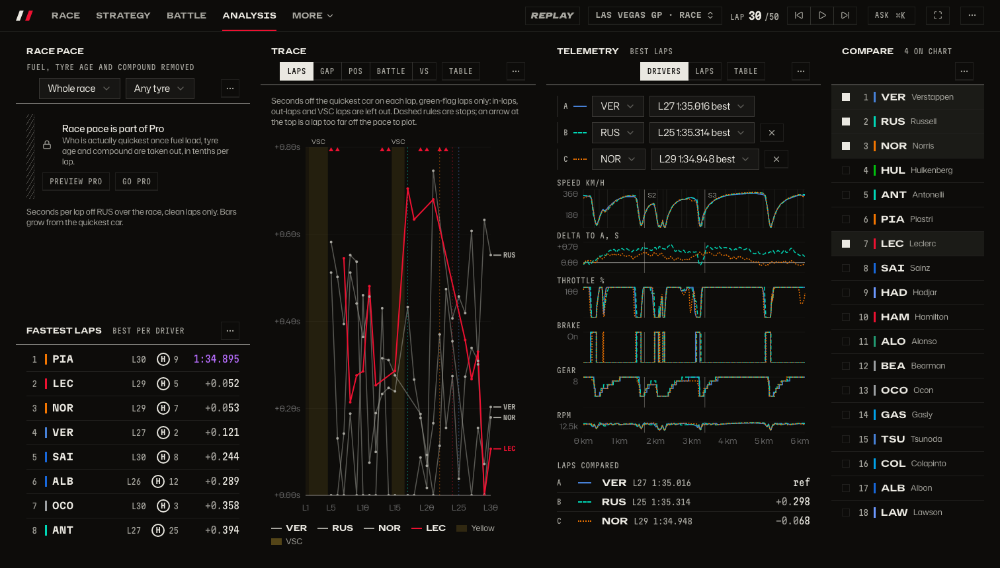

# The race page through a first-time viewer's eyes

T31, 2026-10-04, on master 802b439 (after T25 and T28), the finished race 11731 opened as a
newcomer would: spoiler protection on, so it opens paused at lap 1. Shots at the owner's laptop
sizes and a phone are in `race-page/before-*.png`; a reviewer who saw only the shots wrote the
findings below.

Before, at 1512×860 and on a phone:

More sizes: [1280×720](race-page/before-1280x720.png), [1440×900](race-page/before-1440x900.png),
[1920×1080](race-page/before-1920x1080.png), [Replay at 1512×860](race-page/before-1512x860-replay.png).

## Measured

Vertical page scroll beyond the window, in pixels:

| Size      | Page scroll | Below the first screen                             |
| --------- | ----------- | -------------------------------------------------- |
| 1280×720  | 392         | Focus, Race control, Stints; Timing and Replay cut |
| 1512×860  | 415         | Focus, Race control, Stints                        |
| 1440×900  | 432         | Focus, Race control, Stints                        |
| 1920×1080 | 509         | Focus, Race control, Stints                        |
| 390×844   | 3898        | a phone stacks nine tiles; the map is sixth        |

At 1280×720 the grid hits its smallest row height, so 21 rows plus the bar and the footer are
taller than the window. The footer under the grid adds to every size.

## What a newcomer makes of it

- **First five seconds.** "Results hidden, paused at lap 1" with Play at 60× and Jump to the
  finish is clear. The Replay badge reads as a label, not a control.
- **Moving through the race.** Play is easy to find. Scrubbing is not: the timeline has no
  playhead or handle, nothing says it can be clicked or dragged, and the current lap is only a
  taller bar in the followed driver's team colour (the owner's "red rectangle"). The « and »
  keys have no visible words; "Events" appears only on wide tiles. Getting back after Jump to
  the finish is a guess.
- **Encodings.** Bar height means pit stops on that lap, bar colour means a flag, a purple cap
  means a new fastest lap, dark grey means laps played and light grey laps to come, and the
  blocks above mean events in seven colours (flags, three tyre compounds, lead, passes,
  penalties). None of it has a legend; only the yellow flag at lap 1 was guessed right, from the
  line under the track.
- **Fit.** At 1280×720 the timing list and the line under the timeline run off the bottom; the
  Fights list cuts its rows mid-line at 1512×860; the Duel and Pace now tiles are mostly empty
  space early in a race. Focus, Race control and Stints are unreachable without scrolling at
  every desktop size, and nothing says they exist.
- **No full screen.** The bar and the footer stay; the only way to give the tiles the whole
  screen is the browser's own full screen, which keeps the bar.

## Ranked problems

1. The timeline, the main way to move through a race, has no playhead, no sign it can be
   dragged and no legend for its marks.
2. Tiles are cut or off screen at every desktop size, and the page scrolls.
3. The map, the most telling picture of a race, is a small tile in a corner (sixth on a phone),
   while the timing table takes a third of the screen.
4. No one-step full screen.

## After (T31)

Page scroll is now 0 at 1280×720, 1512×860, 1440×900 and 1920×1080 on every session tab (the phone, 390×844, still
stacks and scrolls). Shots: `race-page/after-*.png`. A reviewer who saw only these shots read
"Drag or click to move through the race, Space plays" as the way to move, and named the legend's
block colours; the legend now also says what bar height, dark and light bars and the handle mean.

More sizes: [1280×720](race-page/after-1280x720.png), [1920×1080](race-page/after-1920x1080.png).

What changed: the timeline has a playhead with its lap, a legend, key hints on hover and a
first-visit hint; the Race tab is map-first with a compact tower; the regrouped tabs (Race,
Battle, Strategy) each fit one screen; F or the bar's key goes full screen; tiles resize by their
edge and collapse to their header; Race tiles lead with a headline in words.

### The newcomer, on the final build

A Sonnet reviewer who saw only the Race tab at 1512×860 and 390×844 (a593081 plus the final fixes):

> I'd start with the strip of small bars under the map. The page itself tells me to "Drag or click
> to move through the race, Space plays." I'd click a spot on the strip, then drag the handle
> labelled "L30" left or right. I'd press the play button, or Space, to watch it run. [...]
> Dark bars have been played and light bars are still to come (sure). A tall bar is a pit stop
> (sure). The handle labelled L30 is where I am now, lap 30 of 50 (sure). Yellow blocks are yellow
> flag, virtual safety car or safety car; red is a red flag, penalty or car out; white outline is a
> new leader; purple is fastest lap (all sure). Guessing: the grey pit-stop swatch looks like the
> plain bars, and I don't know what MINE means.

Open from it, now fixed: the Pit stop swatch is a blue bar and larger legend text, the MINE filter
says on hover what it shows, lists end on whole rows, and each tile shows a corner grip and a
collapse key on hover and keyboard focus.

### The four tabs, final, 1512×860

The design review of these shots found cut rows on Strategy, Battle and Analysis, one overlap and a
blank band over the timeline bars at 1920×1080. All lists and tables now end on a whole row through
one rule on the tile body (`use-whole-rows.ts`, with `WholeRows` for the long lists), footnotes
show only where they fit, and `e2e/tile-layout.spec.ts` (mock data) and `e2e/real/tile-layout.spec.ts`
(the real race) open every tab at 1280×720, 1512×860, 1440×900 and 1920×1080 and fail on an
overlap, on text running out of a tile that does not scroll, and on a partly shown row.
