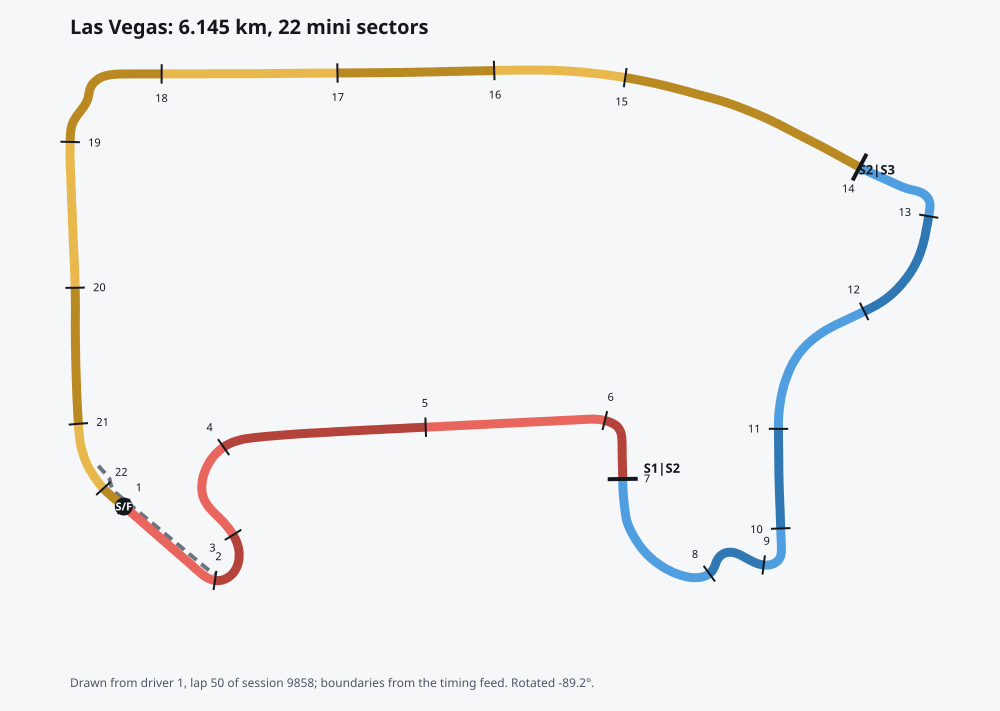

# Telemetry build on the 2025 Las Vegas race

Session 9858, `npm run telemetry -w server -- --key 9858`, cold (no saved outline), on a laptop
(macOS, Apple silicon, Node 24). Format and meaning of the files: [telemetry.md](../product/telemetry.md).

The picture is `las-vegas-outline.svg`: the track coloured by mini sector (tint alternates inside
a sector), numbered ticks at each mini-sector start, heavy ticks where sectors 1/2 and 2/3 meet,
`S/F` the start/finish line, dashed the pit lane. Turned 89° so the long side is horizontal.

## Time

| Step                                                                 | Time         |
| -------------------------------------------------------------------- | ------------ |
| Whole build, outline drawn (read 14 MB of raw, decode, build, write) | 4.4 to 4.9 s |
| Same with the outline saved by an earlier session                    | 4.4 s        |

## Sizes

| Output                                      | Count | Size                                                             |
| ------------------------------------------- | ----- | ---------------------------------------------------------------- |
| Raw `Position.z` + `CarData.z` (not output) | 2     | 7.5 MB + 6.8 MB                                                  |
| Lap files (gzip, with car data)             | 885   | mean 6.1 KB, median 5.9 KB, p95 7.2 KB, max 9.4 KB; total 5.4 MB |
| Lap index `laps.json.gz`                    | 1     | 16.9 KB                                                          |
| Replay chunks, 60 s each, all 20 cars, 4 Hz | 141   | mean 4.2 KB, max 6.5 KB; total 599 KB                            |
| Circuit outline (shared by all sessions)    | 1     | 19 KB                                                            |

The target was well under 50 KB per lap per driver: the largest lap is 9.4 KB.
Replay is under 1 MB for the whole session, so the client can fetch it all or stream it by
minute while scrubbing.

## Checks

- Outline length 6145 m against the official 6201 m (50 laps, 309.958 km;
  [Wikipedia](https://en.wikipedia.org/wiki/Las_Vegas_Grand_Prix)): -0.9%. Closed: the last point
  is one point spacing from the first. 22 mini sectors, matching the 6 + 7 + 9 segments of
  `TimingData`; sector ends 1670 m and 3350 m.
- Lap distance: all 885 laps never decrease. The 823 laps that did not begin or end in the pit
  lane and were not the first lap of the standing start are within 0.001% of the circuit length
  (each runs from one crossing of the line to the next). The 19 first laps are 0.0 to 4.1% off, as
  the grid is behind the line; the 43 laps into or out of the pits are up to 2.3% off, because the pit
  lane's timing line is about 140 m before the line on the projection. They are flagged in the index.
- The feed publishes a lap about 100 ms after the car crossed.
- Lap-file positions agree with the replay chunk to under 3 m (unit test).

## Not done, and why

- Corner numbers: the feed does not publish them; deriving them from curvature would be a guess,
  so they are left out.
- Mini-sector boundaries are placed from when the feed coloured each segment, so each carries the
  feed's delay (10 to 25 m at full speed). No official segment positions are published.
