# Screenshots

All screens are from the mock replay of the 2025 Las Vegas Grand Prix at lap 30. They are
regenerated with `npm run shots` (output in `client/shots/output`, not committed).

Shots run with formula1.com blocked, so driver pictures show their drawn fallback: the race number
on a plate, a generic car outline. In a browser that can reach formula1.com the photos, logos and
cars load over them.

## Wide monitors

Pit wall preset on a 2560px monitor, rows fitted to the window height:

Analysis at 2560px:

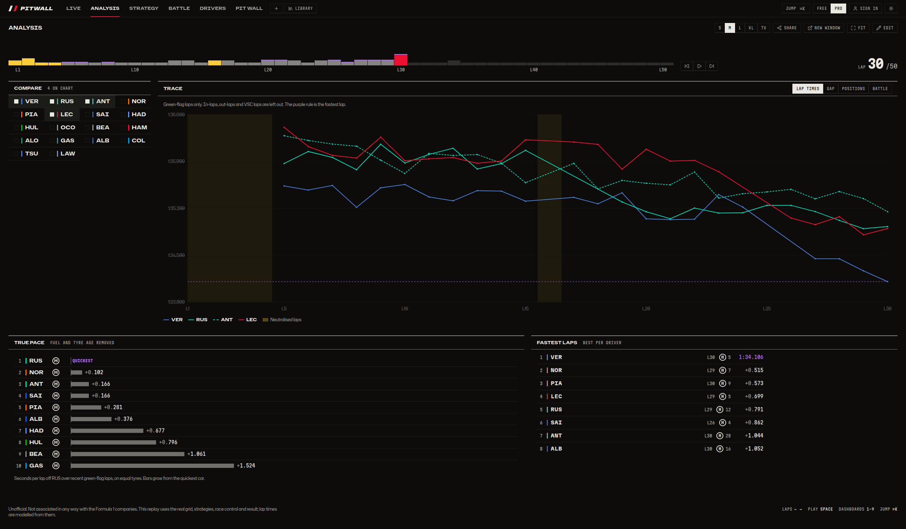

## Desktop

Live:

Battle: timing beside the gap to the car ahead, the gap ladder and the pit stop prediction.

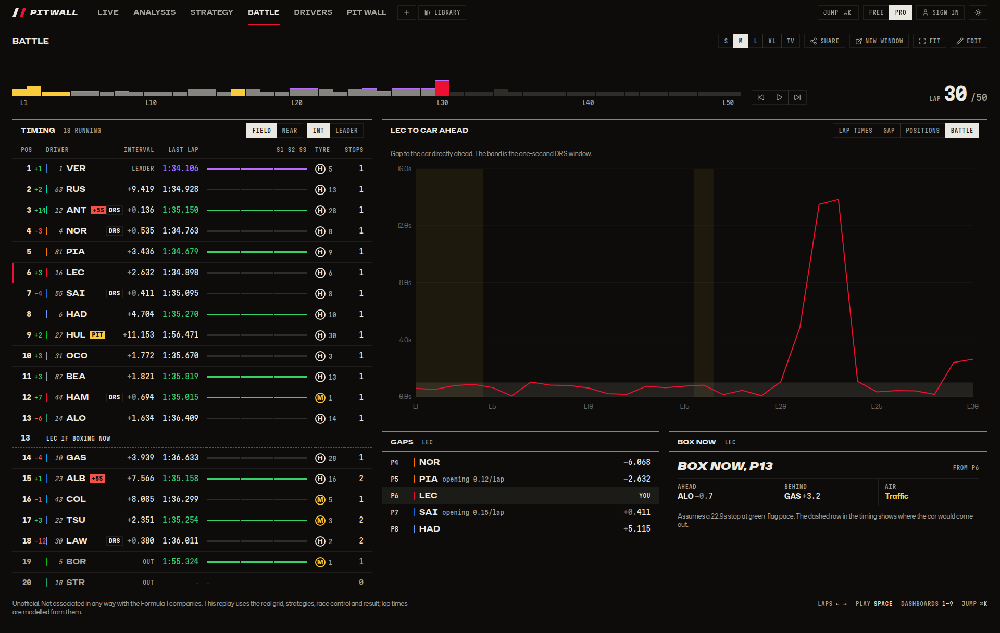

Analysis:

Strategy:

## Building a dashboard

Edit mode: every part of the screen is a tile, the race title and replay keys included. Bars
sit in the gaps above tiles, so nothing changes size while you edit. Drag by the bar, resize from
the edges, add tiles, duplicate, share, export and import. The keyboard works too.

## Drivers

The grid as picture plates in running order, the followed driver large with their car, and
positions lap by lap. Only the followed driver's plate takes the team colour.

At 2560px:

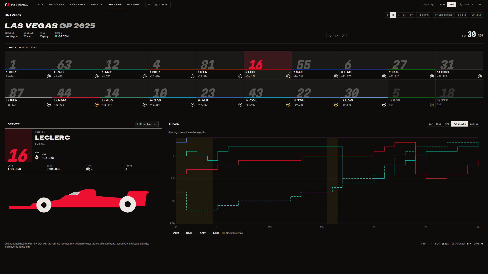

## Library, sharing and first run

The library: your dashboards, the ready-made ones and fan dashboards, each drawn to scale.

A fan dashboard previewed live before adding it. Share links open the same way.

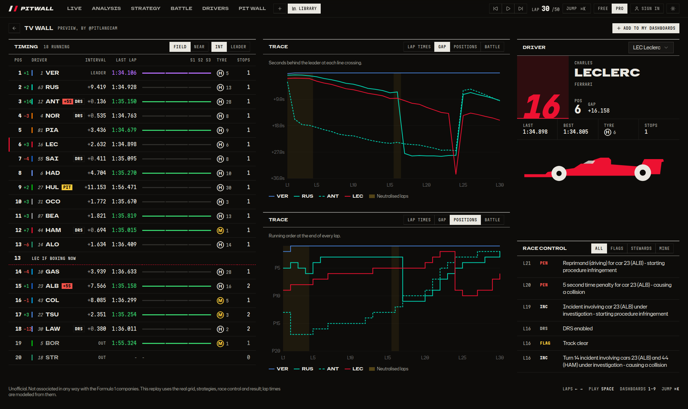

First run: pick a driver and how you watch.

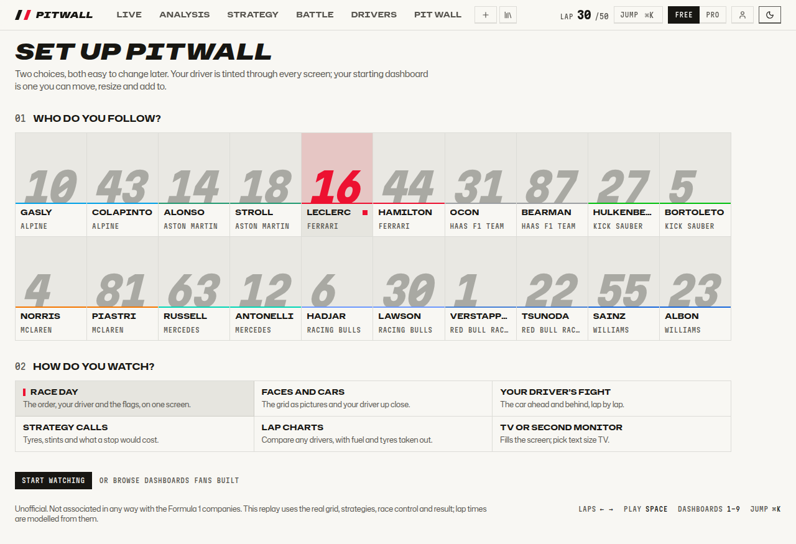

| Library on a phone                                   | Welcome on a phone                                   |
| ---------------------------------------------------- | ---------------------------------------------------- |
| 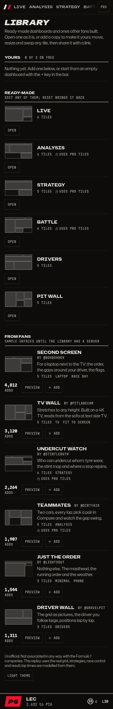 | 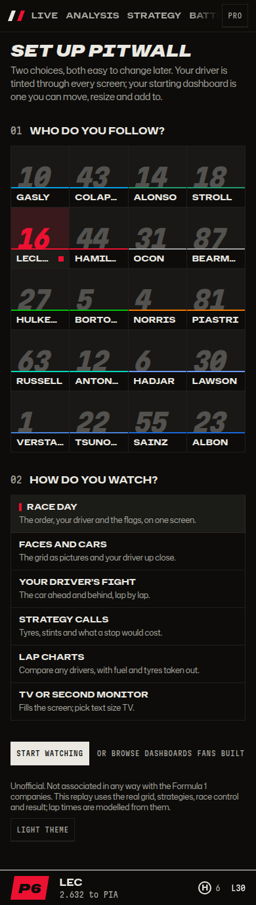 |

## Light theme

| Live, laptop                                      | Analysis, laptop                                          |
| ------------------------------------------------- | --------------------------------------------------------- |
| 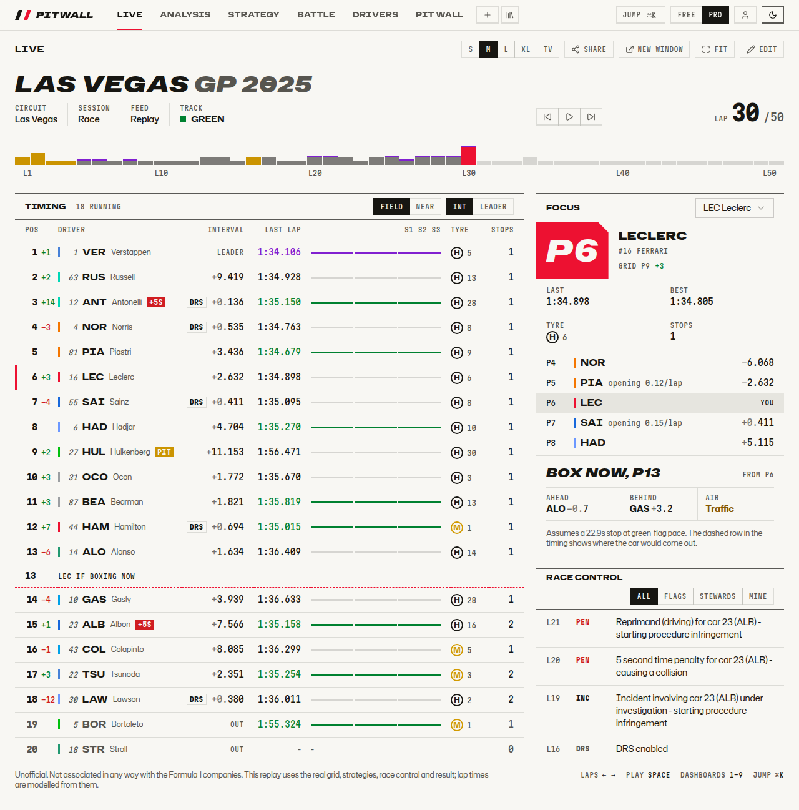 | 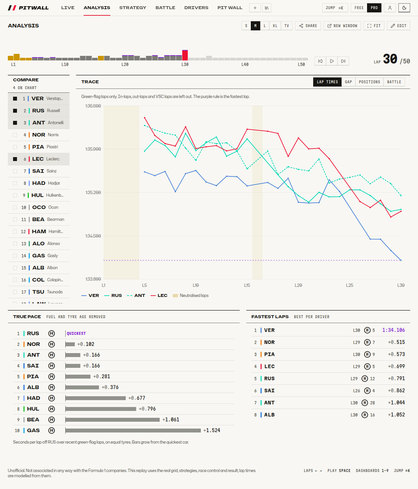 |

Free plan, with Pro tiles locked:

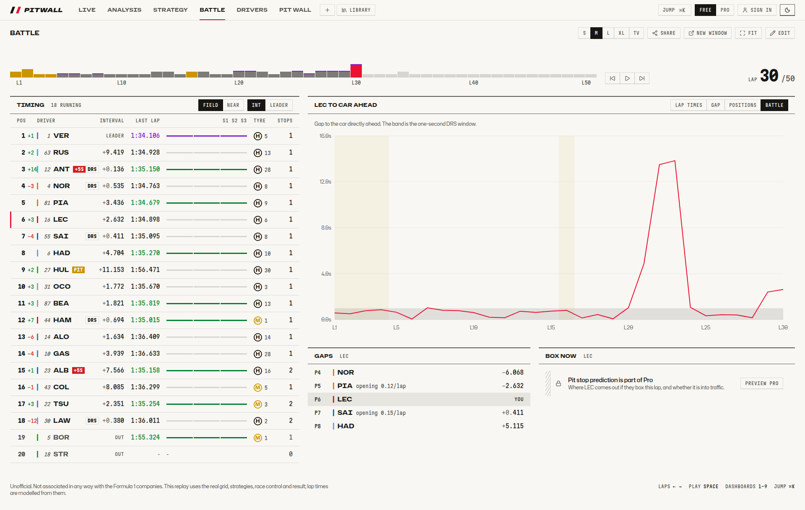

## Tablet

| Live                                             | Pit wall, light                                                |
| ------------------------------------------------ | -------------------------------------------------------------- |
| 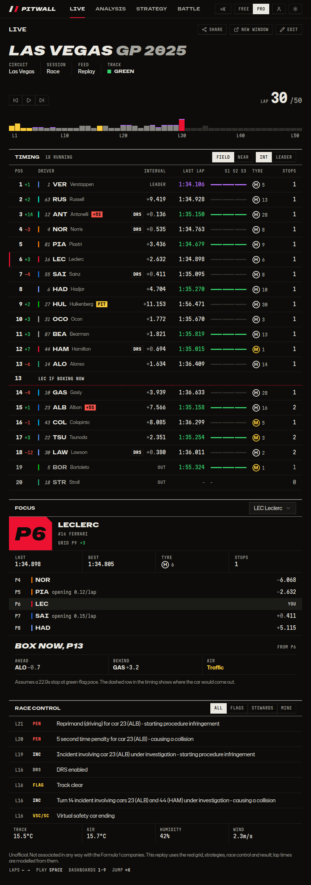 | 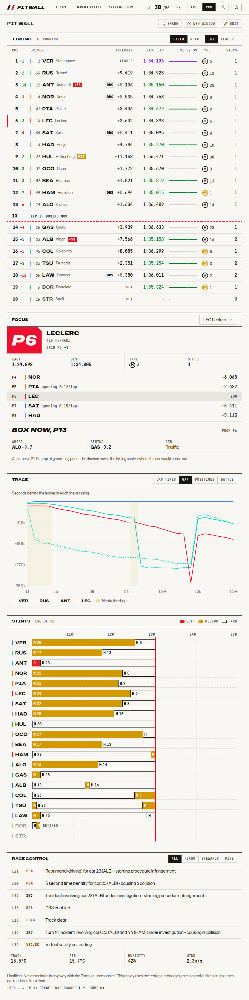 |

## Phones

Narrow screens stack tiles in reading order. The followed driver stays pinned at the bottom.

| Live                                           | Analysis, light                                              | Strategy, 360px                                        | Editing                                                |
| ---------------------------------------------- | ------------------------------------------------------------ | ------------------------------------------------------ | ------------------------------------------------------ |
| 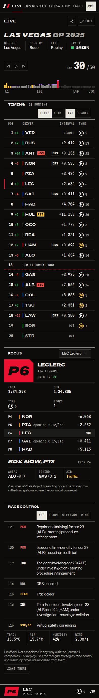 | 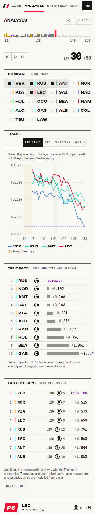 | 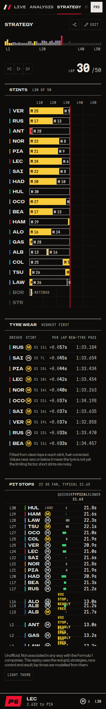 | 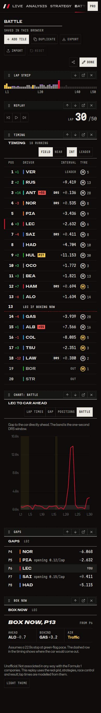 |
