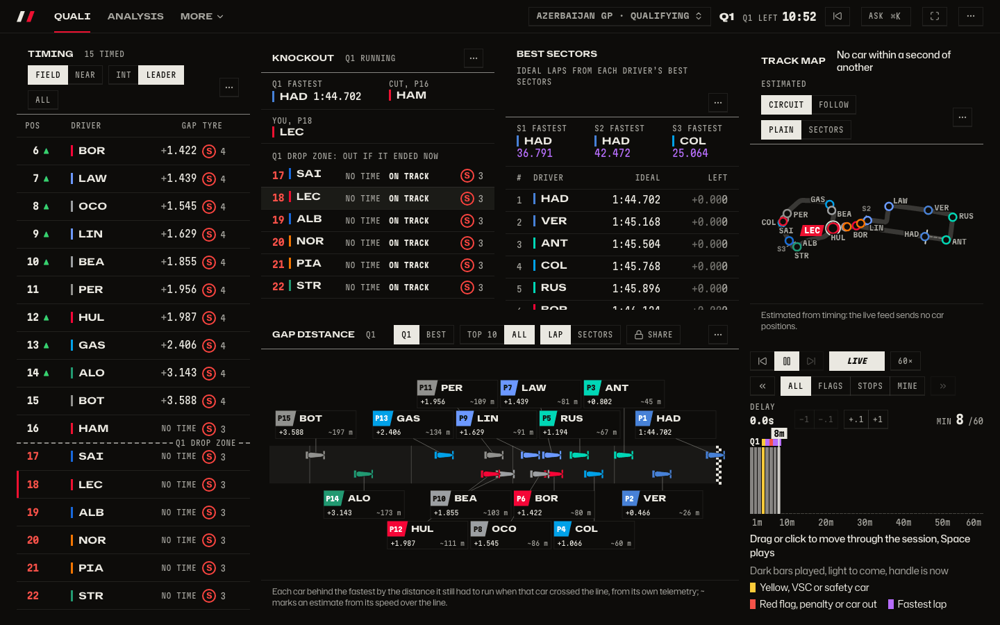
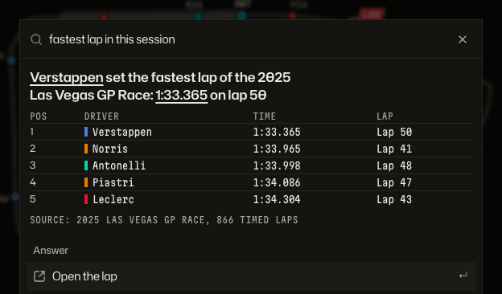
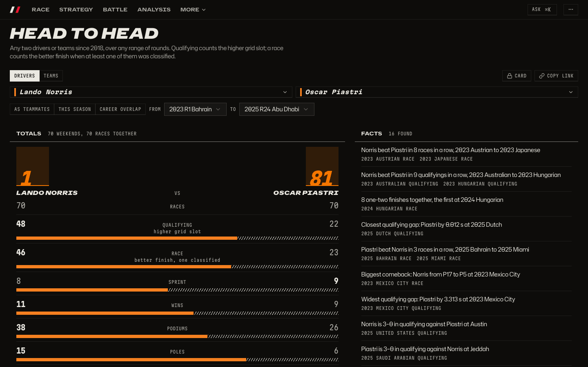
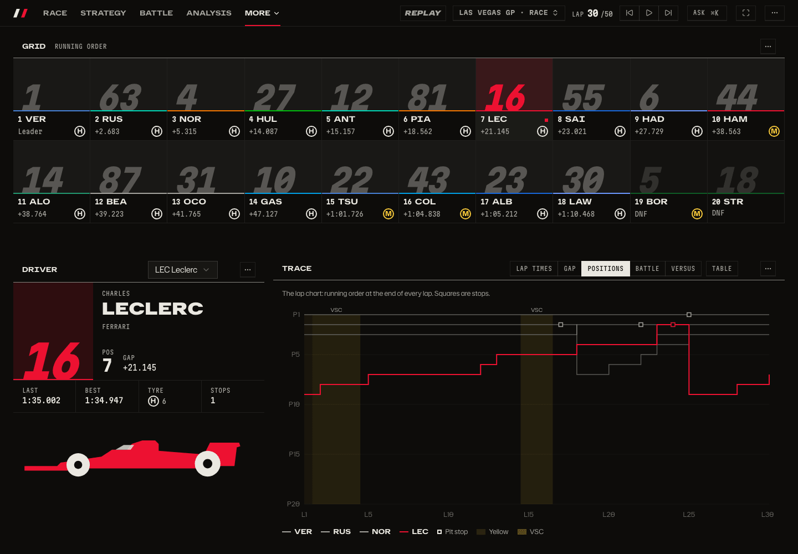
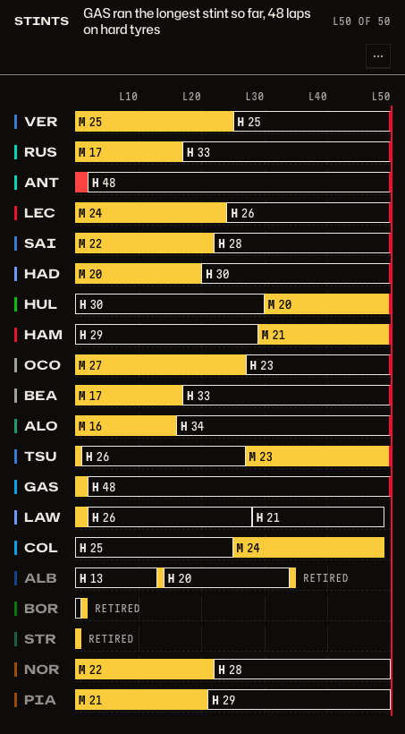
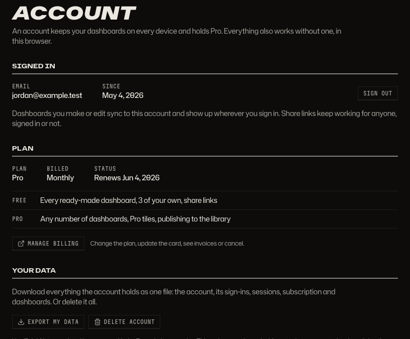

# A tour of Pitwall

Every screen of the product, in pictures. Each page opens with the question it answers, then the screens, then how to get there. How it is built: [architecture](../architecture.md).

The pictures are made by one command, `npm run docs:shots`, from the real data fixture and the mock replay; see [Keeping the pictures current](#keeping-the-pictures-current).

## [Live race](live.md)

What is happening on track right now, and how do I look back without losing my place?



## [Replay any session](replay.md)

What happened in any session since 2018, without the result given away before I want it?


## [The race page](race-page.md)

Where do I look first in a race, and how do I get to the rest without scrolling?


## [Ask](ask.md)

Who won, who was fastest, what was the penalty: ask in plain words, get the answer with its proof.


## [What you can ask](ask-kinds.md)

Results, a driver's weekend, standings, head to head, stewards' decisions, facts and pace: one question and one answer for each.



## [History and head to head](history.md)

How did a season go, and who beat whom over a range of rounds?



## [Watching a race closely](racewatch.md)

Who is racing whom right now, and who is really faster? The Race tab marks the fights on the map; the Battle tab says who is quicker.


## [Drivers and teams](drivers.md)

Who is where, and how did one driver's lap differ from another's?



## [Dashboards and tiles](dashboards.md)

How do I get the screen I want, from a phone to a wall monitor, and share it?


## [Track and telemetry](track.md)

Where is everyone on the circuit, and where does one driver gain on another?


## [Strategy insights](strategy.md)

Who is on which tyre, did the undercut work, and who is really fastest?



## [Accounts and library](accounts.md)

How do I keep my dashboards on every device, go Pro, and publish one for other fans?



## Keeping the pictures current

```sh
npm run docs:shots   # every picture in docs/tour, 1440x900 (390x844 for the phone ones)
npm run docs:links   # every link and image in README.md and docs/
```

`docs:shots` starts its own servers on the `PW_PORT_BASE` ports, reads the committed fixture in `client/e2e/real/data` (set `DOCS_DATA_DIR` to a full import to show more history), and turns the media host off so no formula1.com picture is stored. A picture is written only when its pixels changed, and each stays under 300 kB. Specs live in `client/shots/` (`docs-mock-*`, `docs-real-*` and `docs-live-*`; `docs.ts` and `docs-data.ts` are their helpers). Dark is the default; one light and one phone example per area.
