# Accounts and library

How do I keep my dashboards on every device, go Pro, and publish one for other fans?

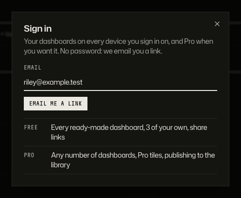

_One email, no password._

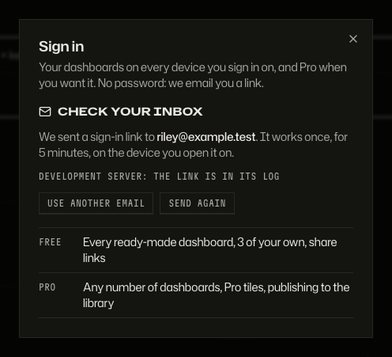

_A sign-in link arrives by email; opening it signs you in._

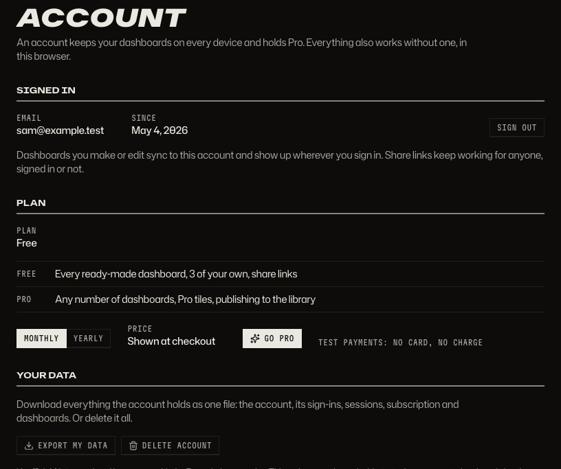

_Plan, Go Pro, and Your data: export or delete everything._

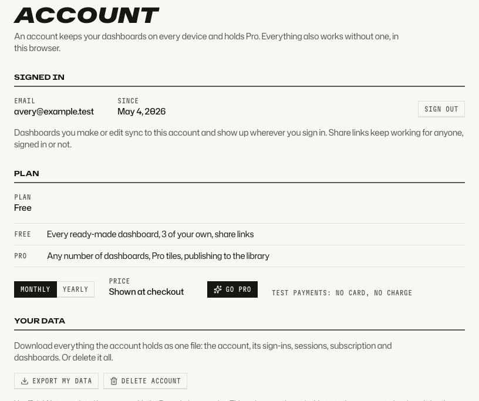

_The light theme._

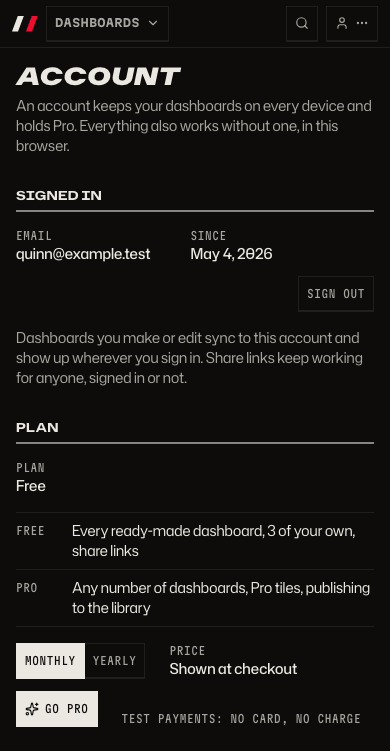

_The account page on a phone._

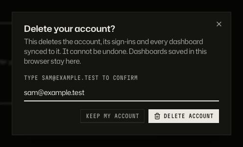

_Deleting asks you to type your email first._

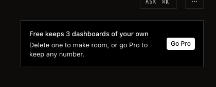

_Free keeps three dashboards of your own; the fourth offers Go Pro._

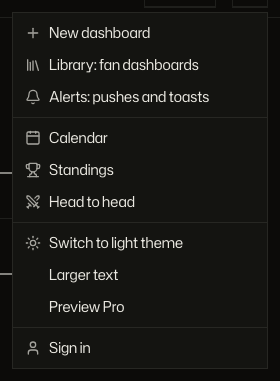

_Preview Pro tries the Pro tiles without paying._

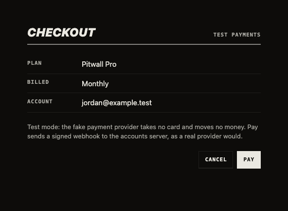

_In development, checkout uses a fake payment provider. In production it is Stripe._

_After paying: Pro, with its renewal date._

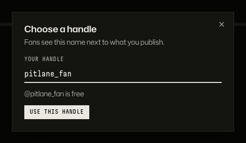

_Pro publishes under a handle chosen once; reserved names and profanity are refused._

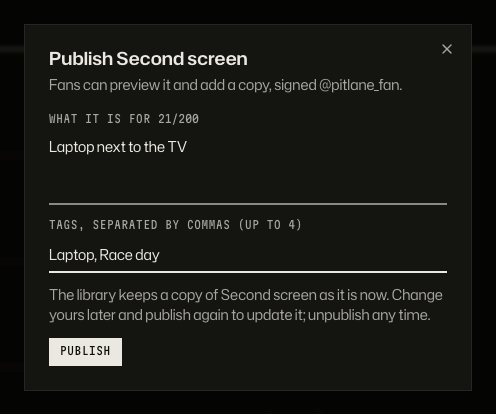

_A description and tags, then Publish._

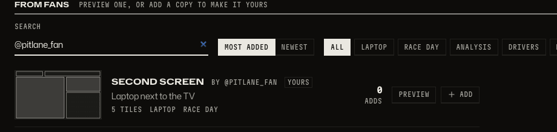

_It appears in From fans with your handle._

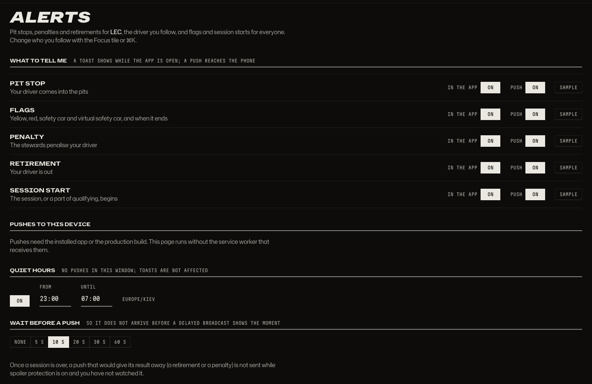

_Alerts: what to be told, quiet hours, and how long to wait before a push._

## How to get there

- The `...` menu in the bar has Sign in (or Account), Library, Alerts and Preview Pro.
- `/account` holds the plan and your data, `/alerts` the alert settings, `/library` the library.
- Accounts in these pictures are throwaway `@example.test` addresses on an in-memory server, deleted after each shot.

Product docs: [Free and Pro](../product/dashboards.md#free-and-pro) and [How people move through the app](../product/flows.md). Hosting, Stripe and email for real: [deploy](../deploy.md).

[Back to the tour](README.md)
