# What you can ask

Which questions does Pitwall answer, and where do I keep looking at the same numbers afterwards? Each kind below has one question to type, the answer, and the tile or page that shows the same thing.

## Results

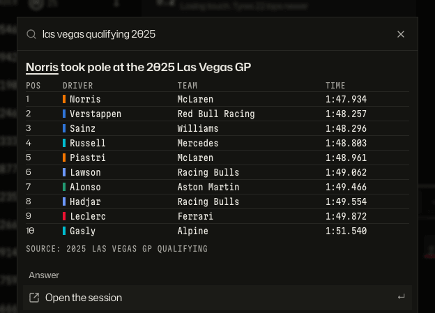

_`las vegas qualifying 2025`: the order of a session, with team and best time. Same numbers: the Timing tile of that qualifying session; the proof link opens it._

## What happened to a driver

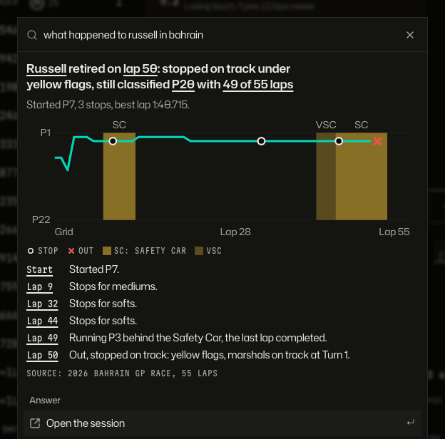

_`what happened to russell in bahrain`: how the race ended, the running order lap by lap, and the key moments, each a link to its lap. Same story, for the race you have open: the Story tile._

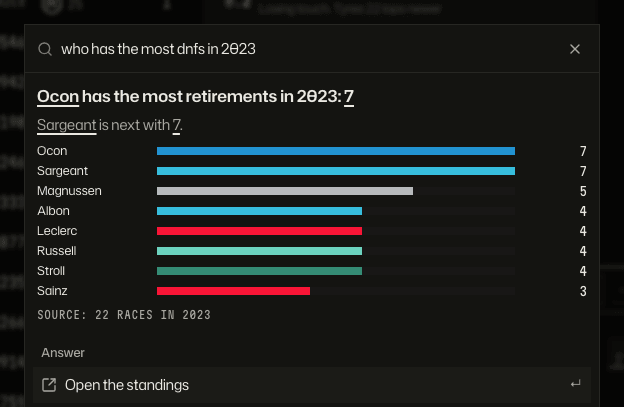

_`who has the most dnfs in 2023`: retirements counted over a season. Same numbers: the season [standings](history.md) page._

## Standings

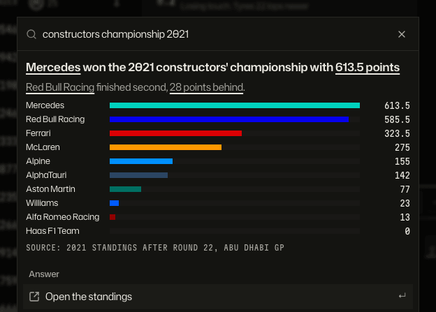

_`constructors championship 2021`: the table in plain words. Same numbers: the Season standings tile, and the Standings page at `view=teams`._

## Head to head

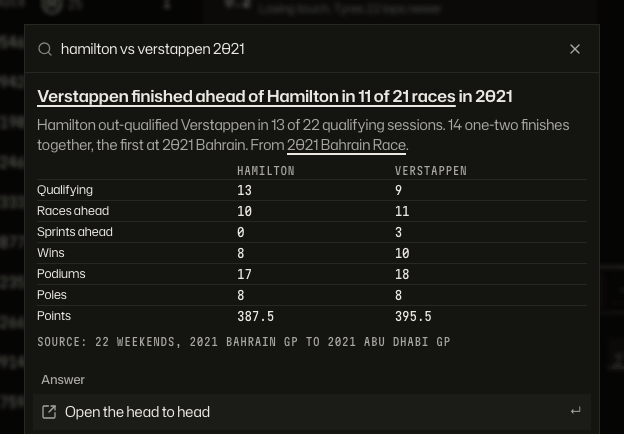

_`hamilton vs verstappen 2021`: wins, poles, podiums and points, side by side. Same numbers: the head to head page, linked from the answer. More in [History and head to head](history.md)._

## Stewards' decisions

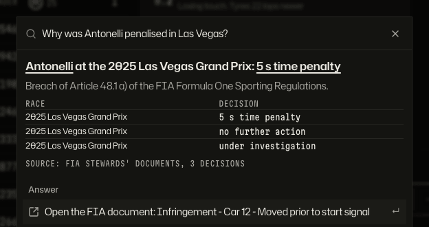

_`Why was Antonelli penalised in Las Vegas?`: the penalty, the infringement and the decisions on file. The proof is the FIA document itself, opened in a new tab._

## Facts

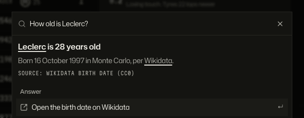

_`How old is Leclerc?`: facts from Wikidata, each with a link to its source. Same facts: the driver's own page, see [Drivers and teams](drivers.md)._

The stewards and facts pictures use sample documents, because the committed data fixture holds none; with a full import the answers read the real ones.

## Pace

_`fastest lap in this session`: the quickest laps with their lap numbers. Same numbers: the Fastest laps tile; the proof link opens the lap._

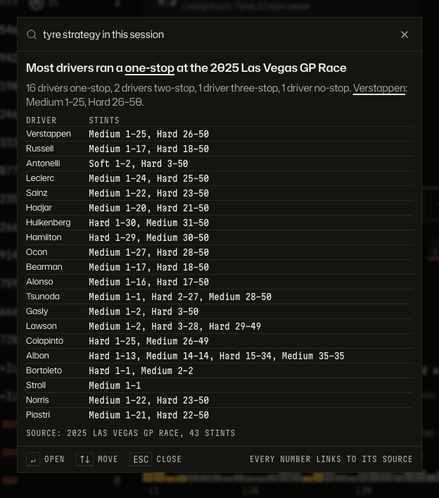

_`tyre strategy in this session`: the most common strategy and the drivers' stints by compound. Same numbers: the Stints tile, and the Strategy page._

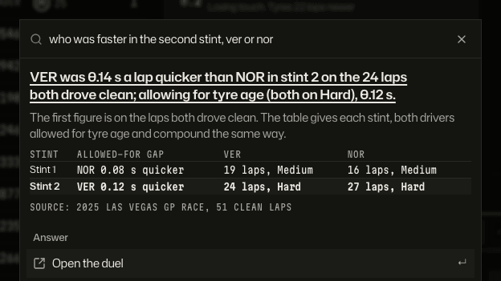

_`who was faster in the second stint, ver or nor`: the gap a lap on the laps both drove clean, then the gap allowing for tyre age. Same numbers: the Race pace tile with both drivers picked; the proof link opens the duel. How each number is worked out: [pace](../product/pace.md)._

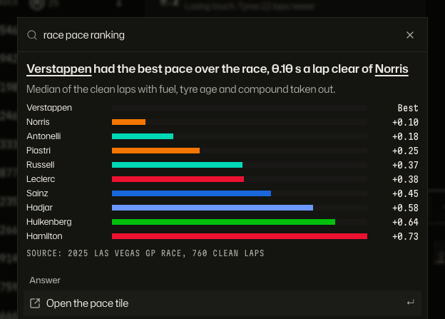

_`race pace ranking`: each driver's median clean lap with fuel, tyre age and compound taken out, as gaps to the quickest. Same numbers: the Race pace tile._

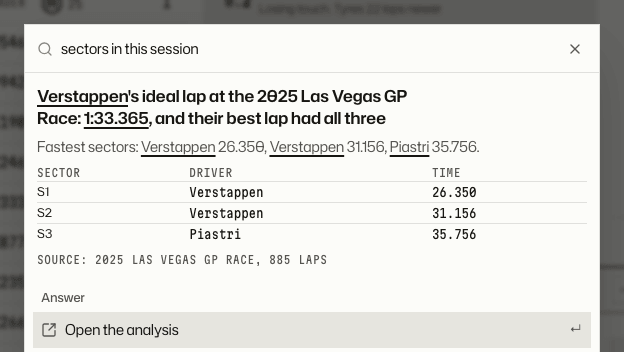

_`sectors in this session`: the ideal lap and who set each sector. Same numbers: the Sectors tile, and the Analysis page. The light theme, for variety._

For who is faster right now, see [Watching a race closely](racewatch.md); more on tyres and true pace in [Strategy insights](strategy.md).

## How to get there

- `Cmd+K` (`Ctrl+K`) or `/` opens Ask from any screen. Type the question as you would say it.
- Questions that say "this session" use the session you have open.
- With spoiler protection on, a result you have not revealed is held back; see [Ask](ask.md).
- An answer's **Add to a dashboard** row puts the matching tile in your layout, where it keeps updating.

Product doc: [How people move through the app](../product/flows.md). More Ask pictures: [Ask](ask.md).

[Back to the tour](README.md)
