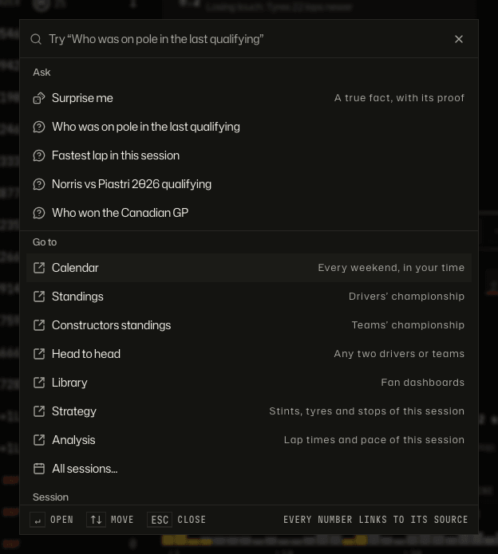
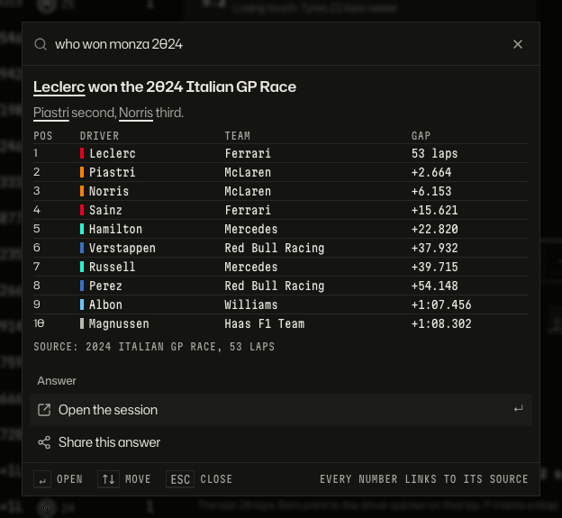
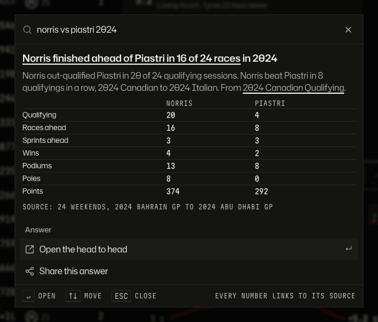
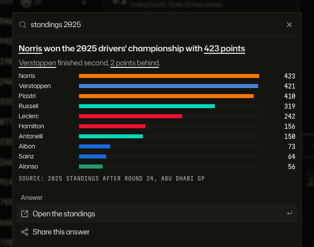
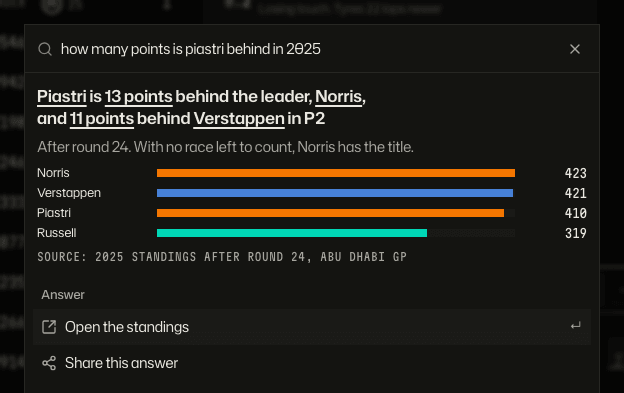
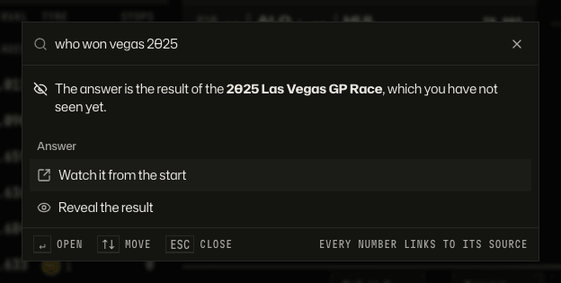
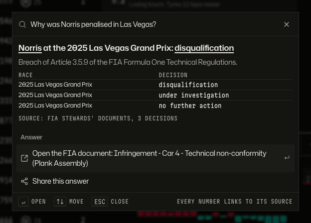
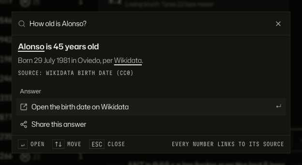
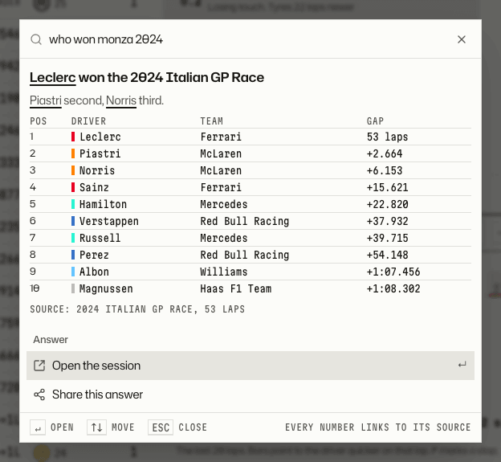
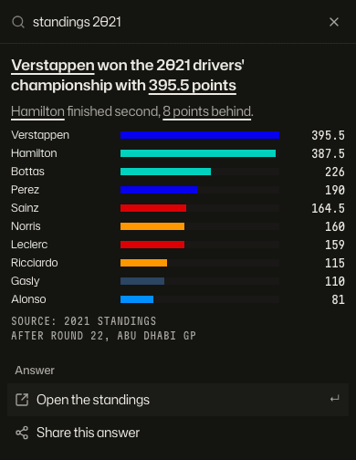

# Ask

Who won, who was fastest, what was the penalty and why: ask in plain words and get the answer with its proof.

_Press `Cmd+K` anywhere and just ask._

_Answers come as a table, with the source one click away._

_Two drivers, one season, side by side._

_Standings in plain words._

_Gaps in plain words._

_With spoiler protection on, Ask holds the result until you choose to see it._

_Stewards' decisions, quoted with the FIA document they come from. This picture uses sample decisions; the committed test data has none._

_Driver facts from Wikidata, each with its source. This picture uses a sample answer too._

_The light theme._

_On a phone, the search button in the header opens Ask._

## How to get there

- `Cmd+K` (`Ctrl+K`) or `/` opens Ask from any screen. `Esc` closes it. `Enter` on an answer follows its proof.
- Questions that work on the committed test data: "who won monza 2024", "norris vs piastri 2024", "standings 2025", "how many points is piastri behind in 2025", "pit stops in this session" (adds a tile).
- With spoiler protection on, "who won vegas 2025" is held until you reveal it.

Product doc: [How people move through the app](../product/flows.md). How the question index is built and queried: [architecture](../architecture.md#4-the-client-routes-dashboards-tiles-insights-ask).

[Back to the tour](README.md)
