# Dashboards and tiles

How do I get the screen I want, from a phone to a wall monitor, and share it?

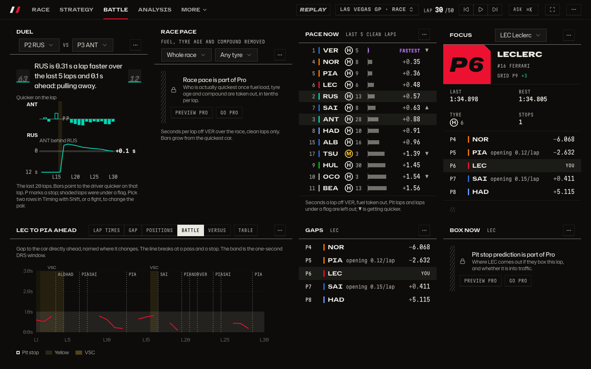

_Ready-made dashboards: pick one and it is already live. Each is one screen: what does not fit is on another tab. Resize a tile by the grip at its corner, no edit mode needed: see [the race page](race-page.md)._

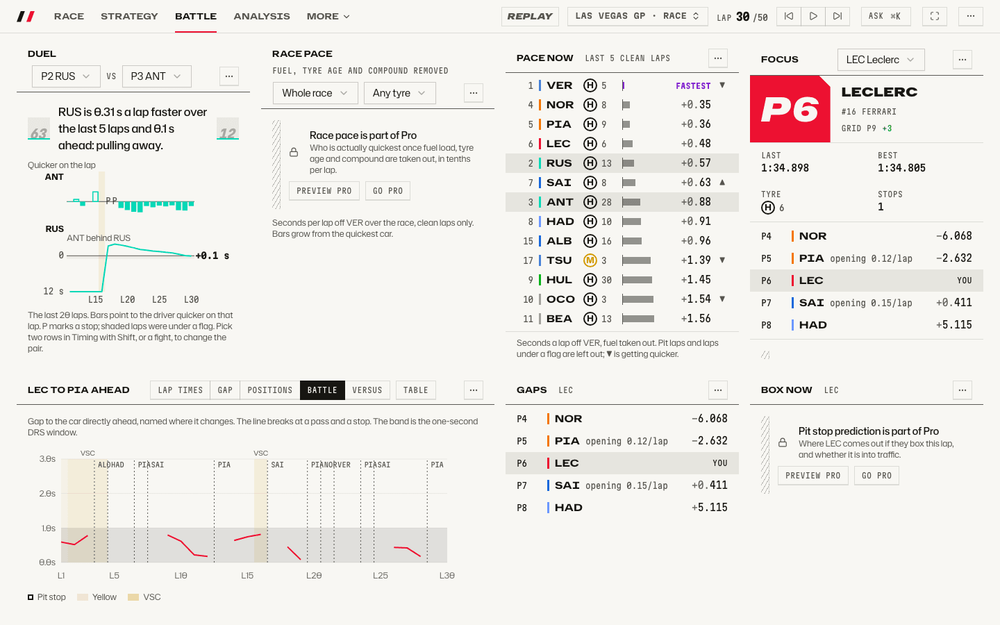

_The light theme._

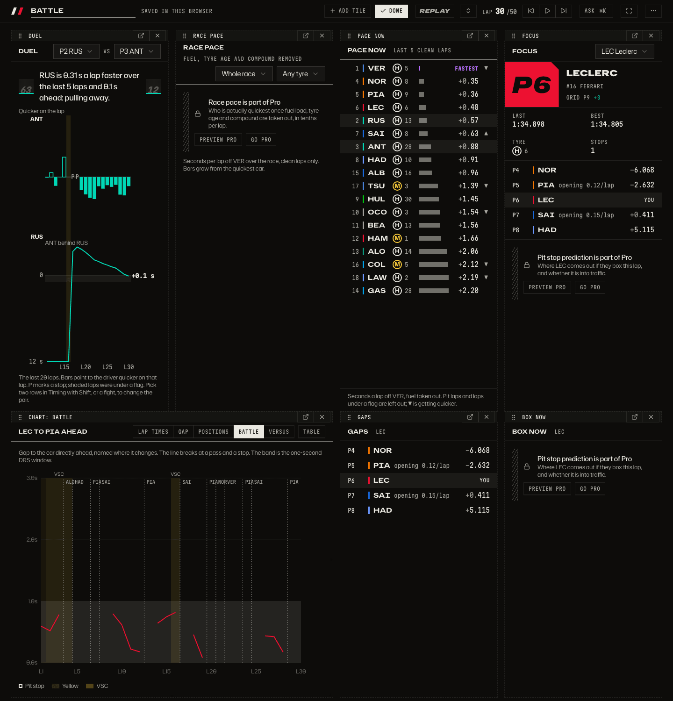

_Edit mode: drag the bar to move a tile, the edges to resize._

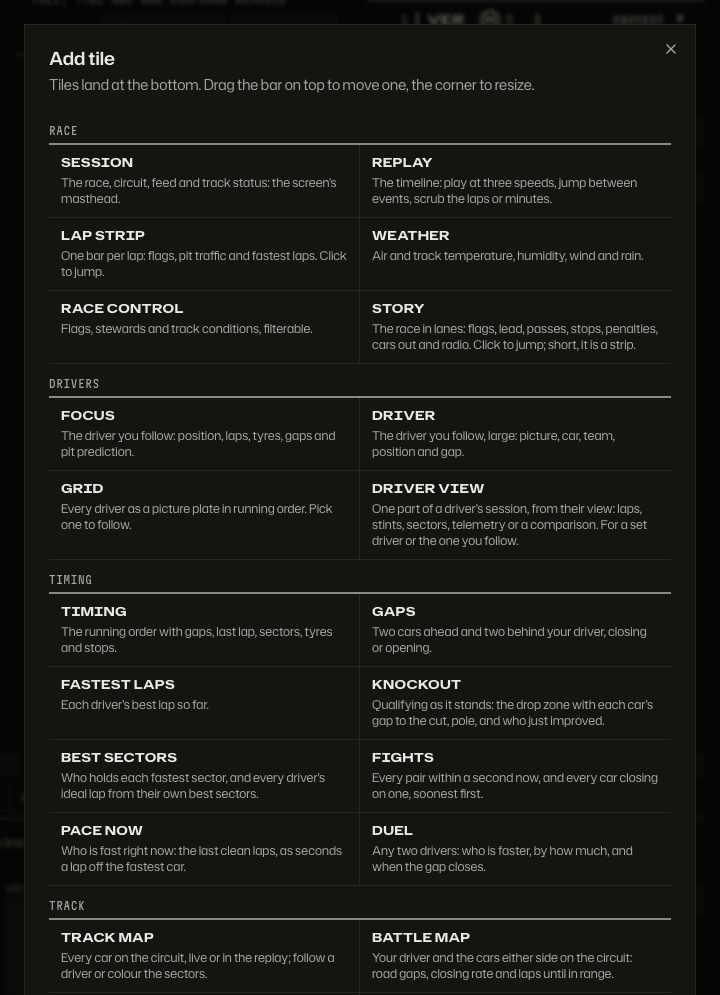

_Add any tile; tiles land at the bottom. Pro tiles are marked._

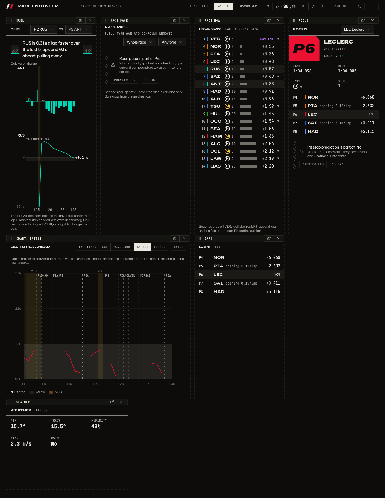

_Start from a ready-made dashboard, make it yours._

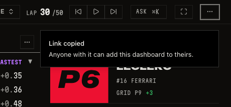

_One link carries the whole layout; no server is needed._

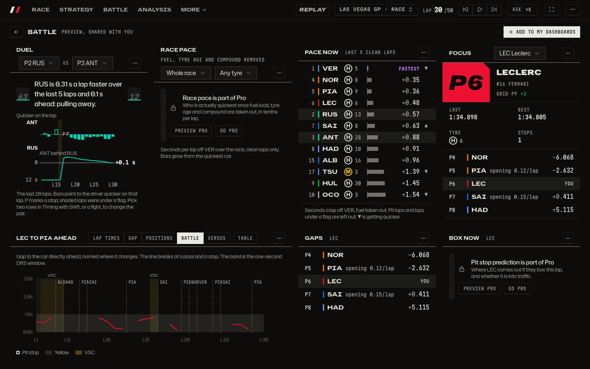

_The link opens as a preview with "Add to my dashboards"._

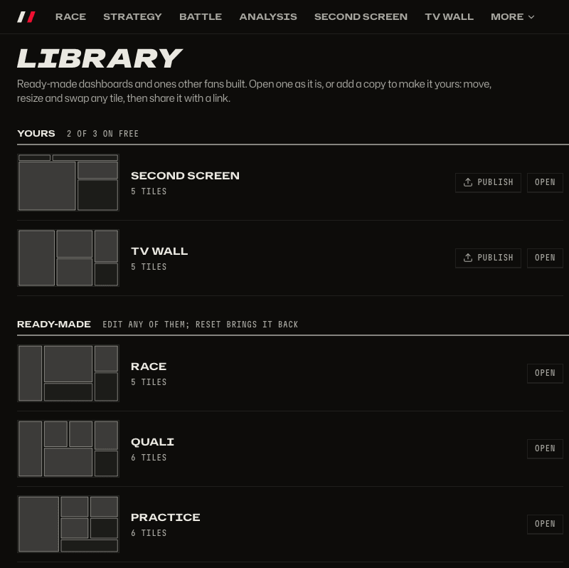

_The library: your dashboards, then ready-made ones, each with a layout thumbnail._

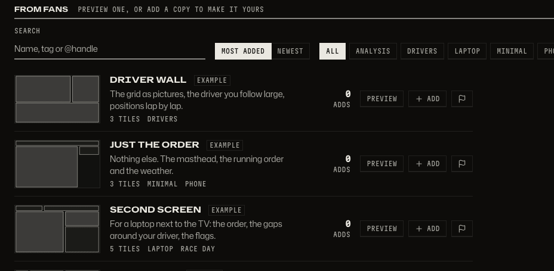

_Dashboards from fans, with search and tags._

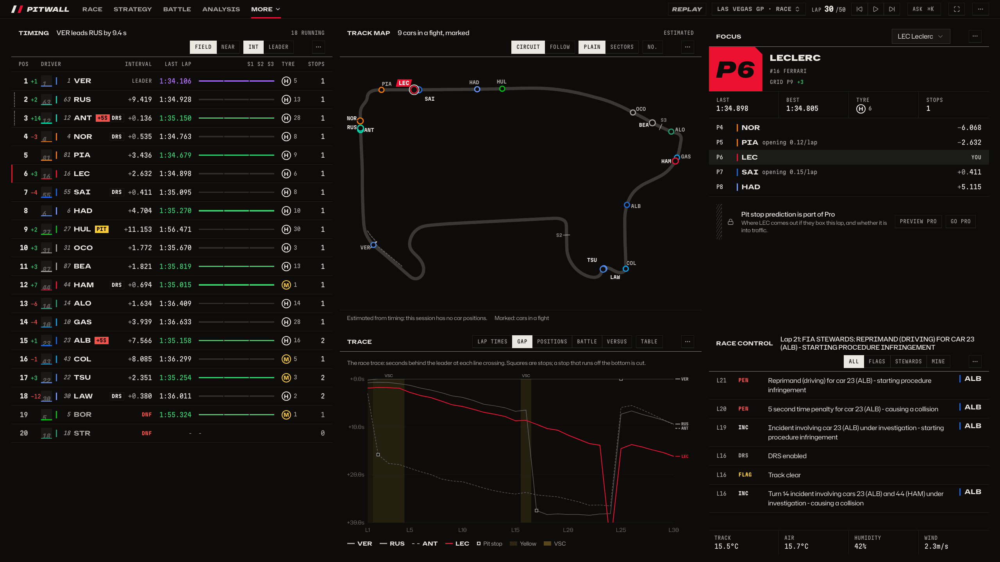

_The Pit wall on a 2560 pixel monitor: tiles fill the window._

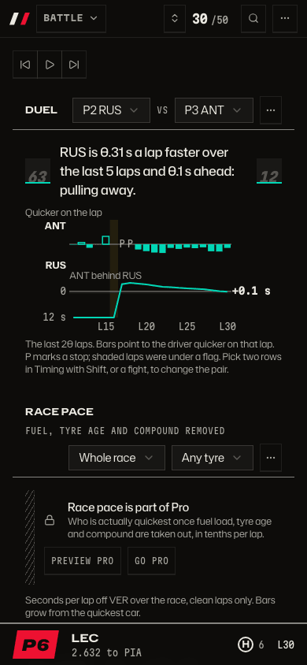

_On a phone the tiles stack into one column._

## How to get there

- `/d/live`, `/d/quali`, `/d/practice`, `/d/analysis`, `/d/strategy`, `/d/battle`, `/d/track`, `/d/drivers`, `/d/wall` and `/d/story` are the ready-made dashboards. `1` to `9` switch between them.
- The `...` button in the bar opens the menu: New dashboard, Library, Edit, Copy share link, Duplicate, Export, Import.
- `/library` has Yours, Ready-made and From fans. A shared link opens at `/shared?d=...`.
- Keyboard: focus a tile's "Arrange" grip, then arrows move it and `Shift` with arrows resize.

Free keeps three dashboards of your own; Pro keeps any number, unlocks Pro tiles and publishing.

Product doc: [Dashboards and tiles](../product/dashboards.md), including [Free and Pro](../product/dashboards.md#free-and-pro). Step by step: [How people move through the app](../product/flows.md).

[Back to the tour](README.md)
