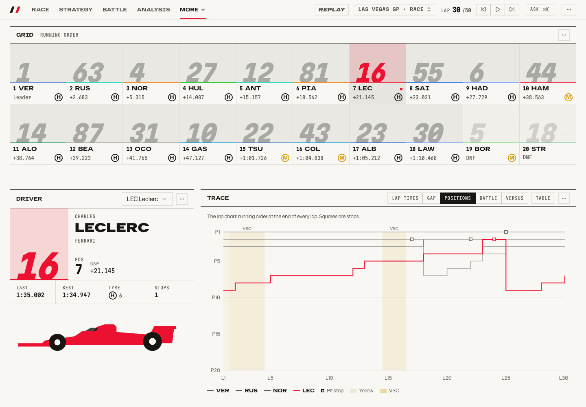
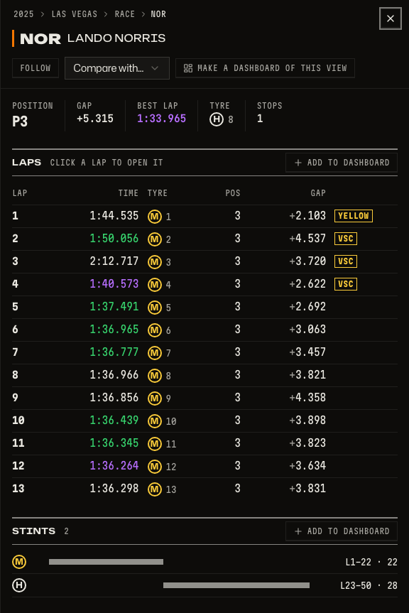
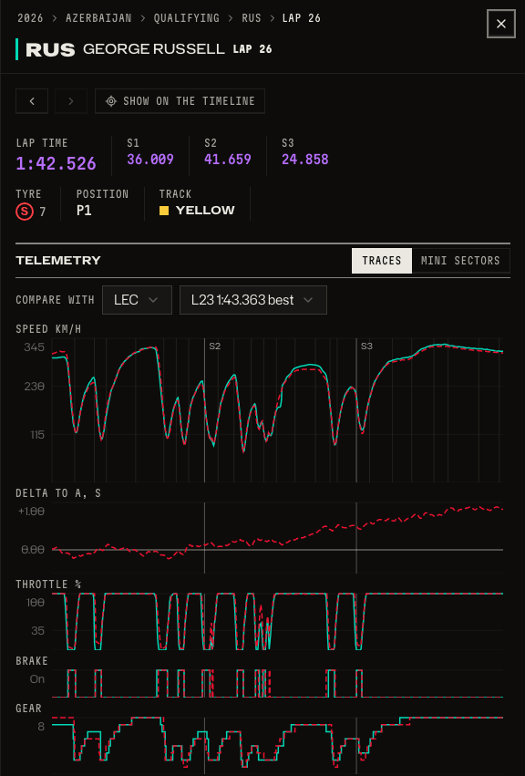
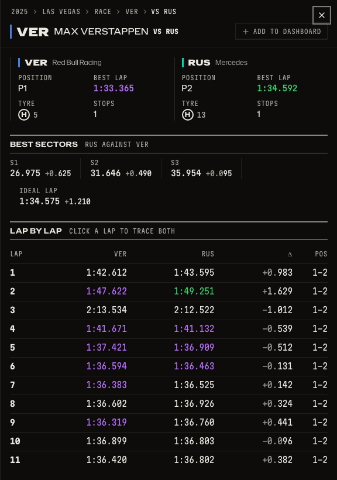
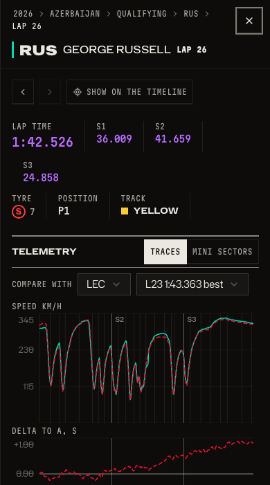

# Drivers and teams

Who is where, how did one driver's lap differ from another's, and how do two drivers compare lap by lap?

_The Drivers dashboard: everyone on the grid, one driver up close._

_The light theme._

_Click a driver for every lap and stint._

_One lap, traced against a rival's: speed, delta, throttle, brake and gear._

_Two drivers compared, lap by lap._

_Telemetry fits on a phone._

Driver, team and car pictures load from the media host in your browser when its terms allow. These pictures were taken with that switched off (`VITE_F1_MEDIA=off`), so you see the drawn plates every screen falls back to. Teams are shown through the constructors' standings in [History and head to head](history.md).

## How to get there

- `/d/drivers?session=9858&lap=30` is the dashboard.
- `/session?session=9858&car=4&lap=30` opens the driver sheet over a session.
- `/session?session=11373&car=63&carLap=26&vs=16` is a lap against another driver; `/session?session=9858&car=1&vs=63&lap=30` compares two drivers.

Product doc: [Dashboards and tiles](../product/dashboards.md).

[Back to the tour](README.md)
