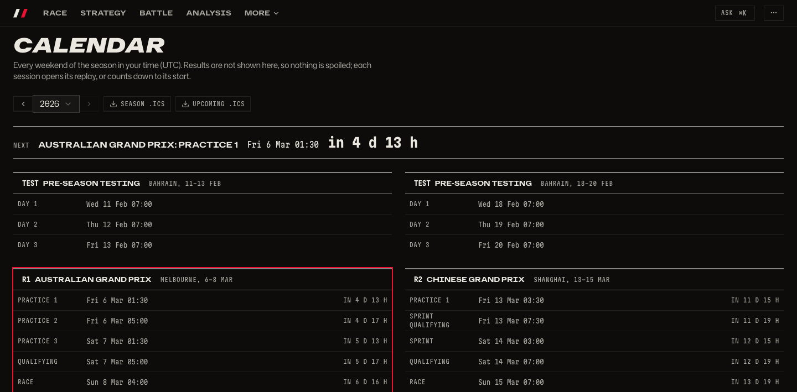
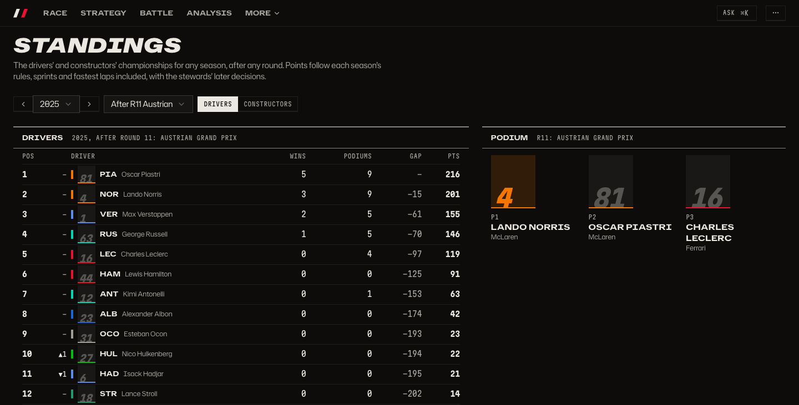
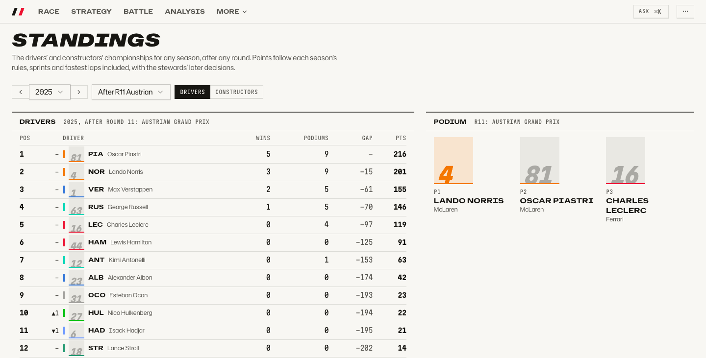
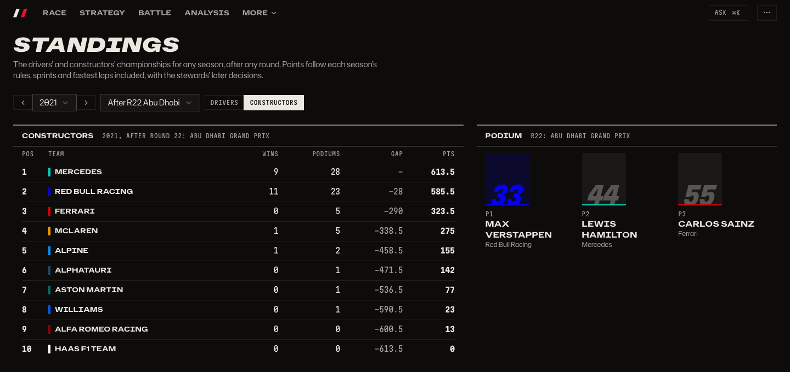
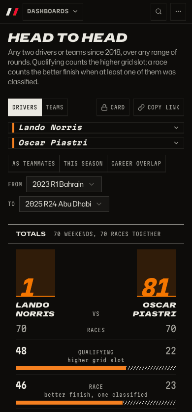
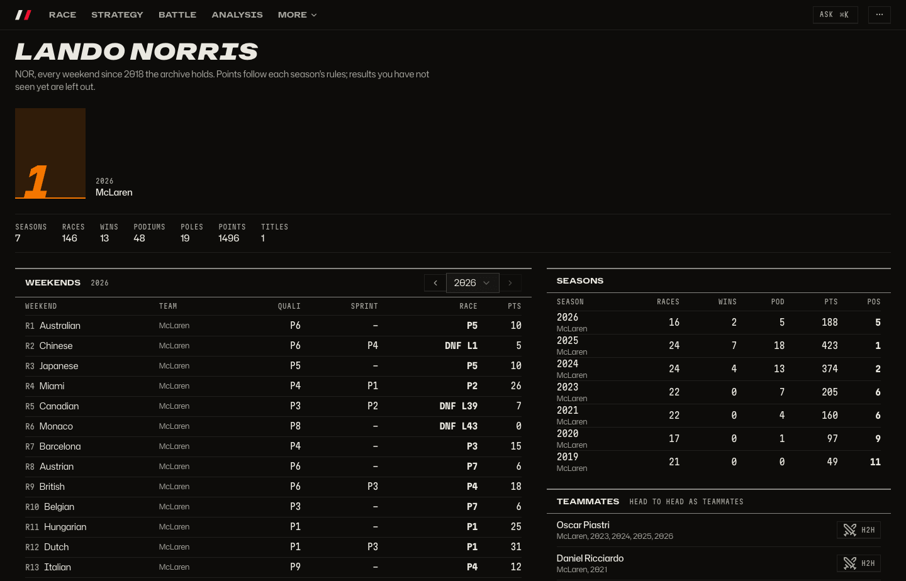

# History and head to head

How did a season go, who beat whom over a range of rounds, and what is a driver's career at a glance?

_Every weekend in your time, and export the season to your own calendar._

_Standings after any round of any season._

_The light theme._

_Constructors' standings, back to 2018._

_Any two drivers, over any range of rounds._

_Head to head on a phone._

_Every driver's career at a glance._

## How to get there

- `/calendar` for the season and the `.ics` exports.
- `/standings?season=2025` for drivers, `/standings?season=2021&view=teams` for constructors.
- `/h2h` for head to head, `/drivers/lando-norris` for a driver page.
- Ask reaches the same data: `Cmd+K`, then "norris vs piastri 2024".

Product doc: [History](../product/history.md). How the results index is built: [architecture](../architecture.md#data-directory-rebuild-corrections).

[Back to the tour](README.md)
