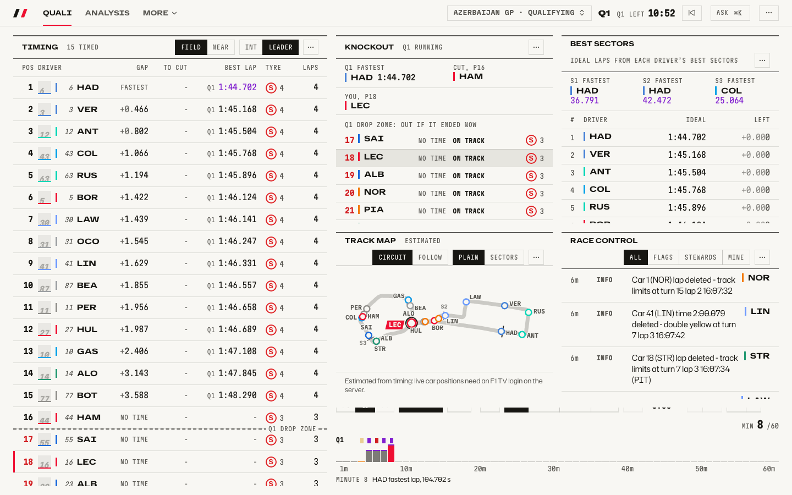
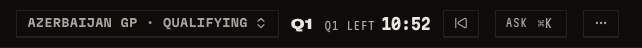
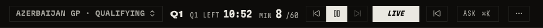
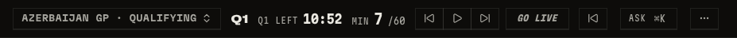
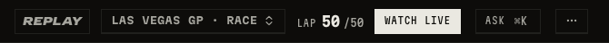
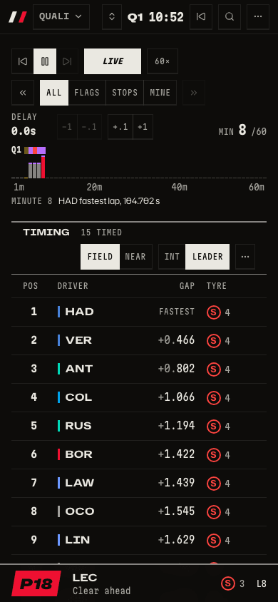

# Live race

What is happening on track right now, and how do I look back at the last minute without losing my place?

_Qualifying while it happens: the order, the knockout line and who would go out, updated live._

_The light theme is a full second theme, not an inversion._

_The bar names the session and counts the part down._

_The live key sits beside play, lit while you follow the session. On a dashboard with a Replay tile it sits there instead._

_Step back to look at the past; one press of the key, or `L`, returns you to live._

_Another session is live? One key takes you there._

_On a phone the tiles stack into one column._

## How to get there

- Open `/session` while a session is running. The live key beside play reads `Live`.
- Press `←` to step back, `→` to step forward, `L` to return to live.
- On a saved session's page, the `WATCH LIVE` key appears while another session is live.
- If the connection drops, the bar shows `Connecting`, `Stale` or `Reconnecting` in a dashed outline.

Product doc: [How people move through the app](../product/flows.md). Wire format: [the live protocol](../product/live-protocol.md). How a message gets from the feed to a tile: [architecture](../architecture.md#2-one-live-message-from-the-feed-to-a-tile).

[Back to the tour](README.md)
