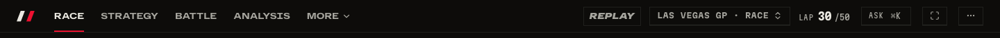
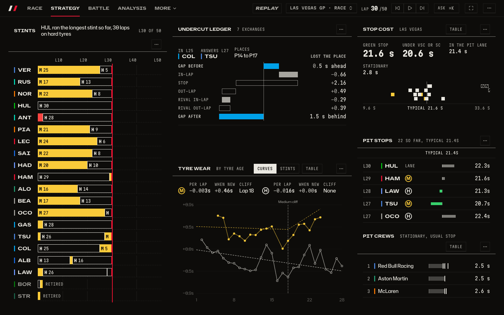
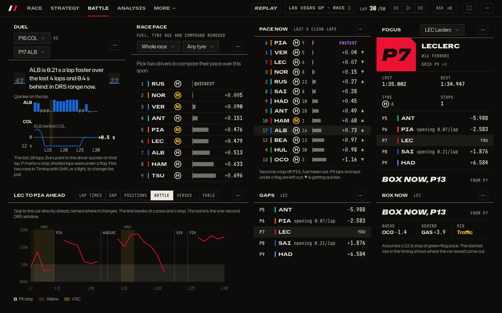
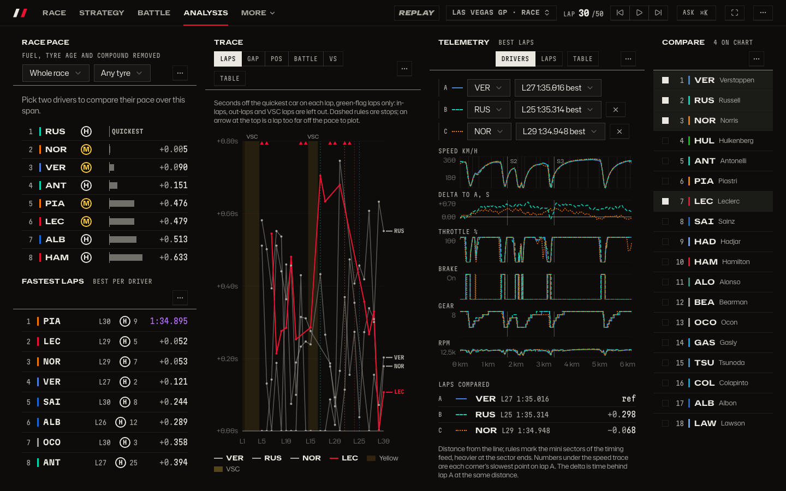
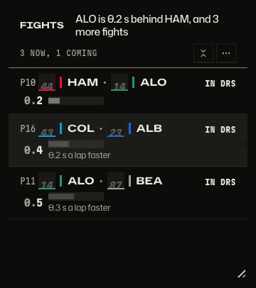
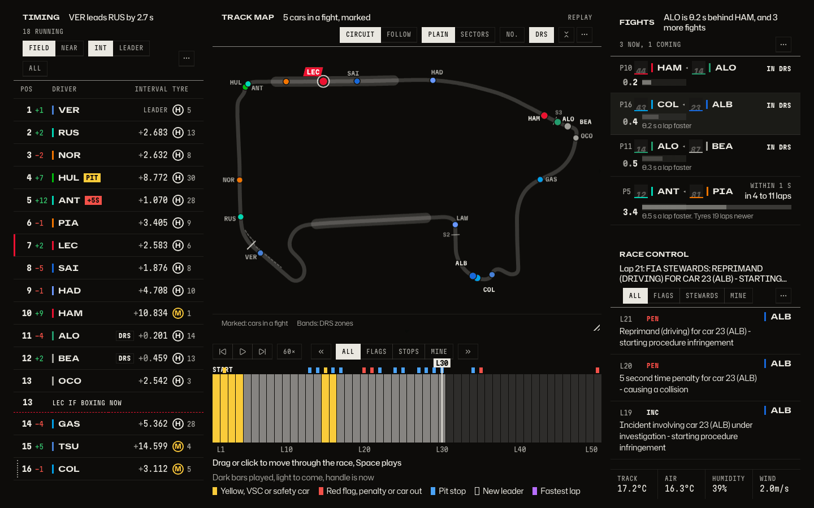

# The race page

Where do I look first in a race, and how do I get to the rest without scrolling?

_The Race tab leads with the track map, the largest tile, with the cars in a fight marked on it. The tower is compact (position, driver, gap, tyre), Fights and Race control sit to the right, and the timeline is at the bottom. Each tile leads with a headline in words, such as "VER leads NOR by 4.3 s"._

_The bar names the tabs that suit the session: Race, Strategy, Battle and Analysis, with the rest under More. A dashboard is exactly one screen on a laptop and up, so what does not fit is on another tab, never below the fold._

_Strategy: stints, tyre wear, the undercut ledger and pit stops, all on one screen._

_Battle: the Duel, Race pace, Pace now and Focus on top, the battle chart, Gaps and Box now below. How to read them: [Watching a race closely](racewatch.md)._

_Analysis: race pace, the fastest laps, the lap time chart, telemetry and the compare view._

_The timeline is the way through the race. A playhead with a handle and its lap shows where you are; drag it or click anywhere along the barcode. A legend says what the marks mean: yellow for flags, red for penalties and cars out, blue for pit stops, a new leader, a fastest lap. The first visit shows a hint, and it goes after you use it._

_Every tile resizes by a grip at its bottom right corner and folds to its header with a collapse key. Both appear on hover and keyboard focus, with no edit mode. Lists end on a whole row, and the rest scrolls inside the tile._

_`F` goes full screen: the bar hides and the tiles grow into its place. The pointer at the top edge, or `B`, brings the bar back; `Esc` leaves._

## How to get there

- `/session?session=9858&lap=30` opens the Race tab. `/strategy`, `/d/battle` and `/analysis` open the others, and `1` to `9` switch between tabs.
- Drag or click the timeline to a lap; `Space` plays; `Shift` with the arrows jumps between events.
- `F` full screen, `B` shows or hides the bar in full screen, `Esc` leaves.
- On a phone the tiles stack: Replay, Fights, Timing, then the map.

Why the page looks like this: [the race page through a first-time viewer's eyes](../research/race-page-first-view.md), with its before pictures. Product doc: [Session layouts](../product/dashboards.md#session-layouts) and [full screen](../product/dashboards.md#full-screen).

[Back to the tour](README.md)
