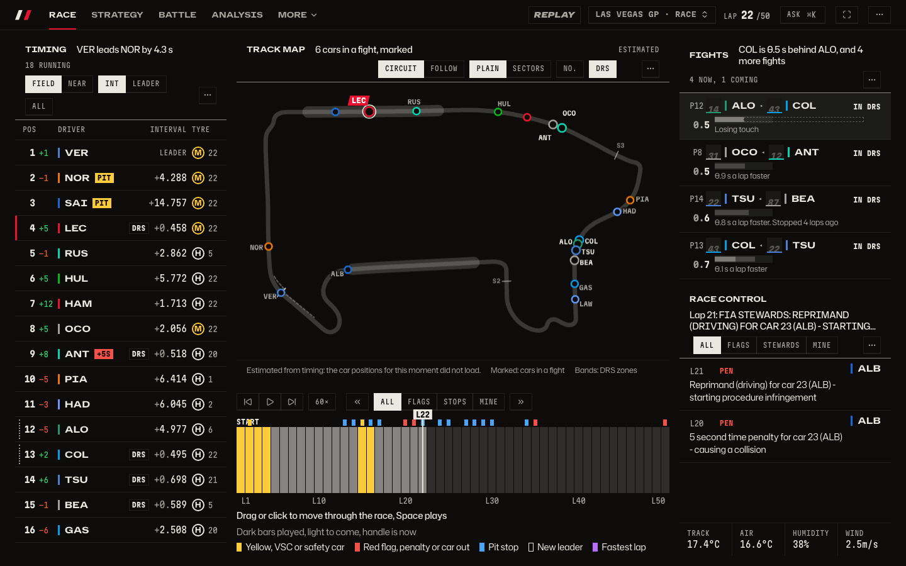
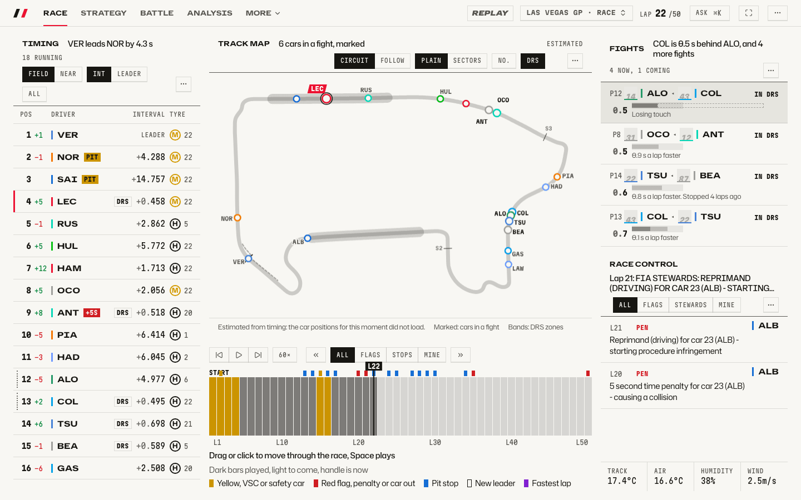
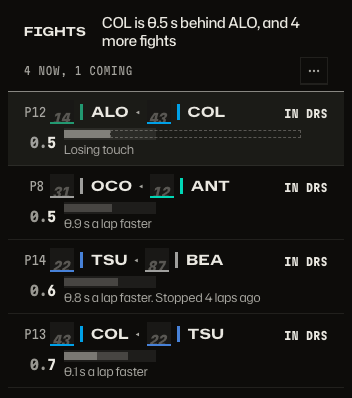
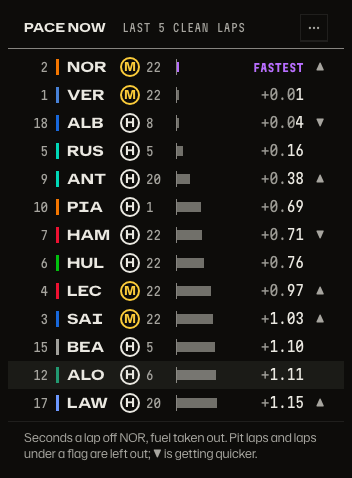
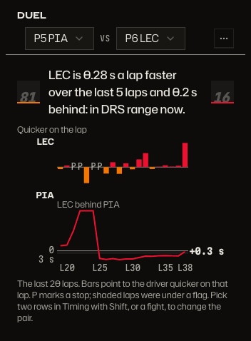
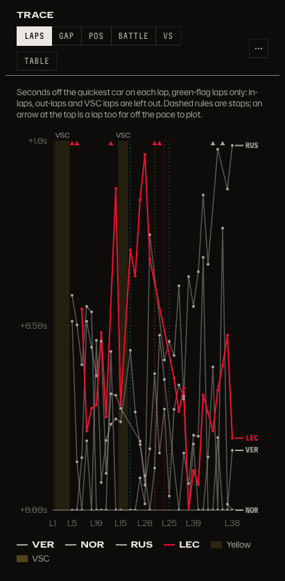
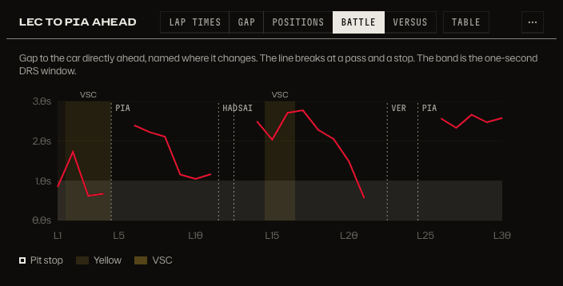
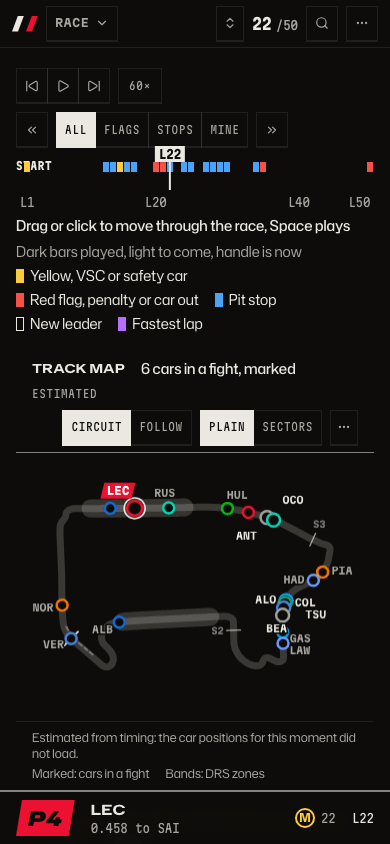

# Watching a race closely

Who is racing whom right now, who is faster, and is the car behind really catching the one ahead?

_The Race tab leads with who is racing whom: the cars in a fight are marked on the track map, and Fights ranks the pairs beside it. Who is faster is on the Battle tab, below._

_Dark is the default; light is one setting away._

_Fights ranks every pair racing now and every car closing on the one ahead, with why the car behind is faster._

_On the Battle tab, Pace now ranks the field by seconds a lap off the fastest car over recent clean laps._

_The Duel, also on the Battle tab, compares two drivers lap by lap, with the gap and a one-line verdict._

_Lap times read as seconds off the quickest car, with stops, flags and off-scale laps marked, and names at the line ends._

_The Battle chart shows the gap to the car ahead, with the car named where it changes and the one-second DRS window shaded._

_On a phone, Replay and Fights come first._

The live key sits beside the play control while a session is running; see [Live race](live.md) for the bar in each state.

## How to get there

- `/session?session=9858&lap=22` opens the Race tab, with the map and Fights in place.
- `/d/battle?session=9858&lap=38&duel=PIA,LEC` opens the Battle tab with the Duel, Race pace and Pace now.
- Click a row in Fights, or hold `Shift` and click two rows in the timing tower, to put a pair in the Duel; the Battle tab shows it. The address carries `duel=PIA,LEC`, so a duel can be shared as a link.
- `/analysis?session=9858&lap=38&duel=PIA,LEC` shows the delta charts for that pair.
- `/d/battle?session=9858&lap=30&driver=16` opens the Battle chart for one driver.
- `L` goes back to live; `Space` plays or pauses.

The Race tab and the tabs around it: [the race page](race-page.md), and why it is built map-first: [the first-view research](../research/race-page-first-view.md). Product docs: [Dashboards and tiles](../product/dashboards.md) and [How people move through the app](../product/flows.md). How it is built: [the live pipeline](../architecture.md).

[Back to the tour](README.md)
