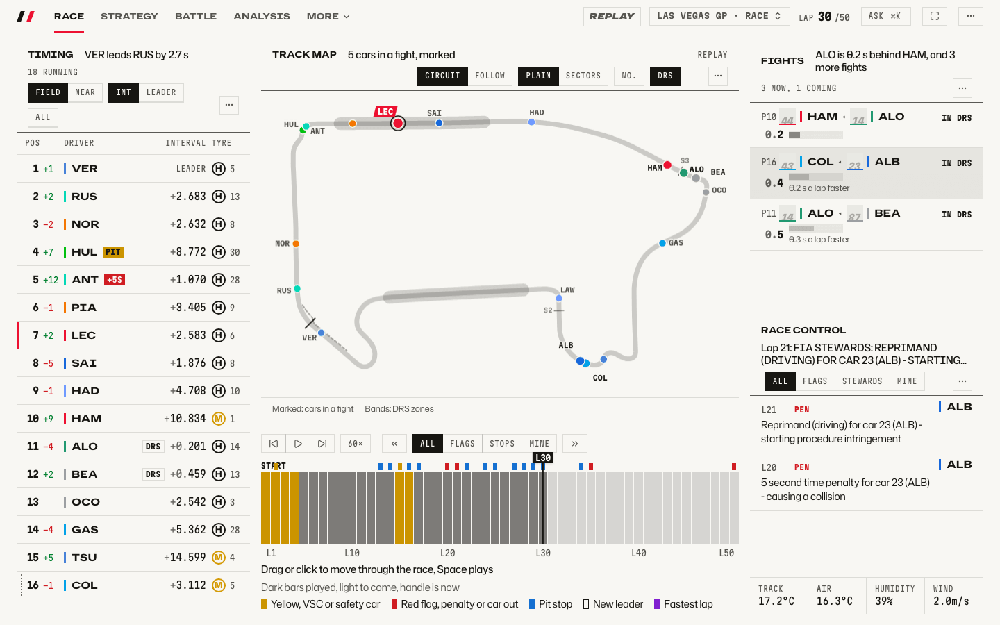
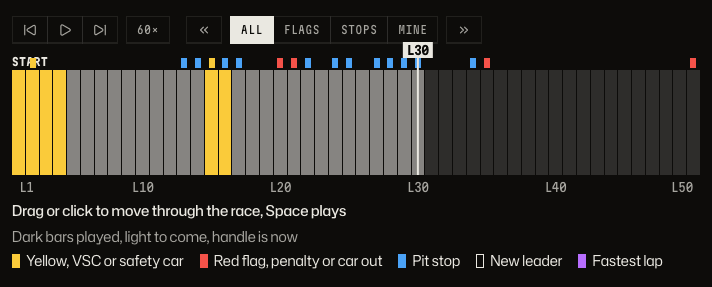
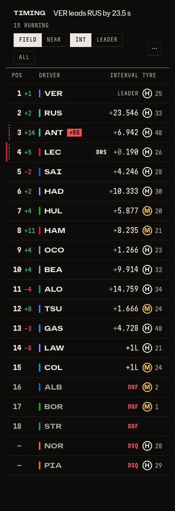
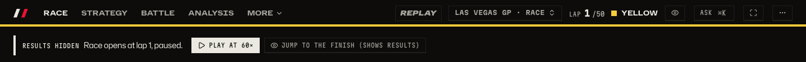
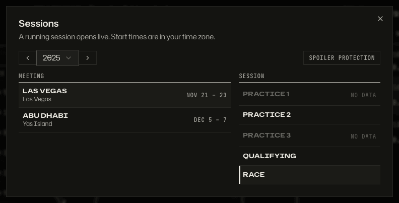
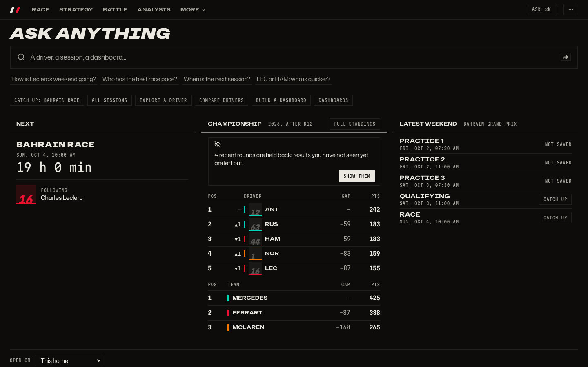
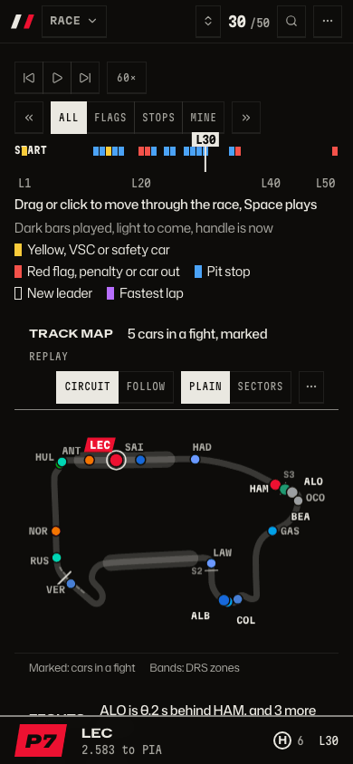

# Replay any session

What happened in any session since 2018, shown the way it unfolded, without the result being given away before I want it?

_Any race since 2018 at any lap, as it was: the track map first, with the cars in a fight marked, then the timing tower, Fights and Race control. More: [the race page](race-page.md)._

_Dark is the default; light is one setting away._

_Play, speed, jump between events, and a barcode of the whole race to scrub through: a playhead with its lap marks the position, and a legend says what the marks mean._

_At the flag the timing tile keeps retirements and disqualifications in the order they happened._

_A finished race you have not seen opens at lap 1, paused. "Jump to the finish" is a separate, deliberate key._

_Pick any session since 2018 by season, meeting and session._

_The home page holds recent rounds back too: the standings stop before them until you choose to show them._

_The same race on a phone._

## How to get there

- `/session?session=9858&lap=30` opens the 2025 Las Vegas race at lap 30. Without `lap` it opens at the finish, or at lap 1 when spoiler protection is on.
- The Sessions key in the bar opens the picker.
- `Space` plays or pauses. `←` and `→` step one lap (one minute in practice and qualifying). `Shift+←` and `Shift+→` jump to the previous or next event that passes the filter (All, Flags, Stops, Mine).
- The speed key cycles 1x, 10x and 60x. Clicking or dragging the barcode scrubs. `F` goes full screen.

Product doc: [How people move through the app](../product/flows.md), which also holds the spoiler rule. How it is built: [replay and the spoiler rule](../architecture.md#3-replay-and-the-spoiler-rule).

[Back to the tour](README.md)
