# Strategy insights

Who is on which tyre, did the undercut work, and who is really the fastest once fuel and tyre age are taken out?

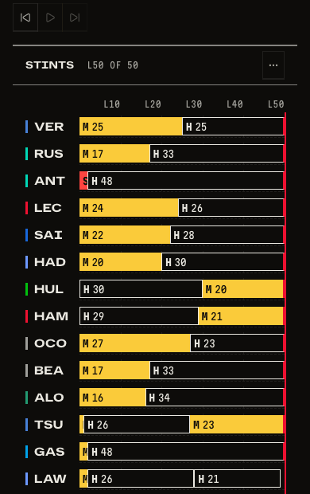

_Every tile also works on a phone._

## Tyres and stops

_Stints: who is on which tyre, and when do they pit?_

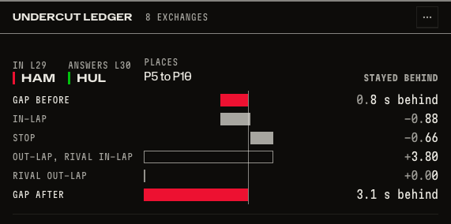

_Undercut ledger: did the undercut work?_

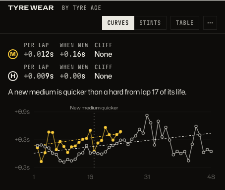

_Tyre wear: how fast is each tyre losing time, and when is a new set quicker?_

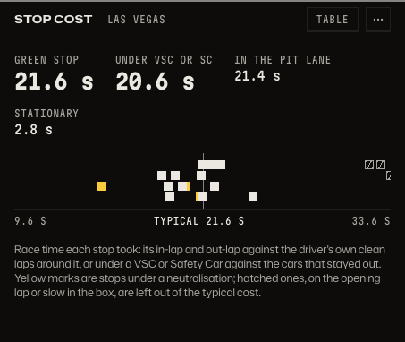

_Stop cost: what does a pit stop cost at this circuit?_

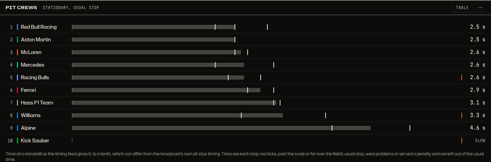

_Pit crews: whose crew is quickest?_

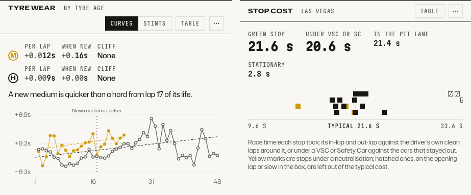

_Both tiles in the light theme._

## Battles and pace

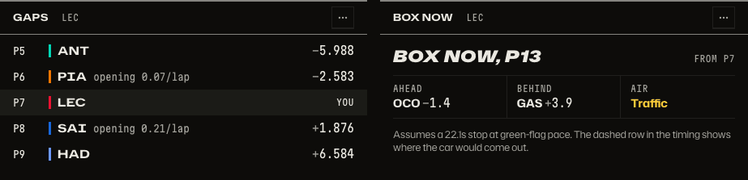

_Battle: who is ahead and behind my driver, and is the gap closing or opening?_

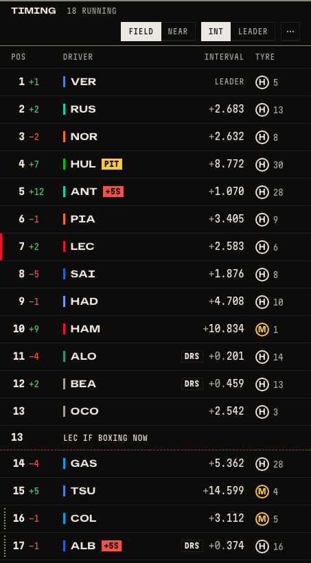

_Box now: what happens to my driver's position if they pit this lap?_

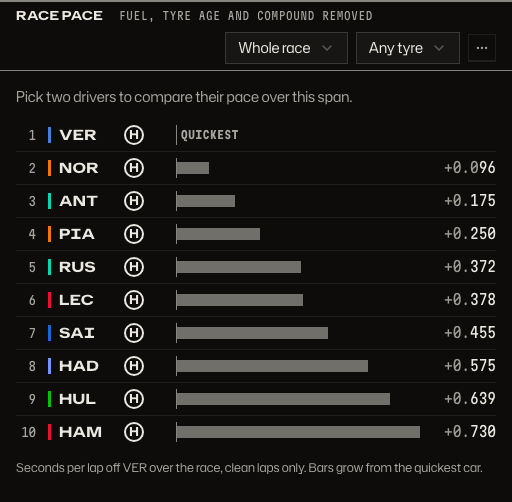

_Race pace: who is really quickest once fuel, tyre age and compound are taken out? Pick a span and a tyre._

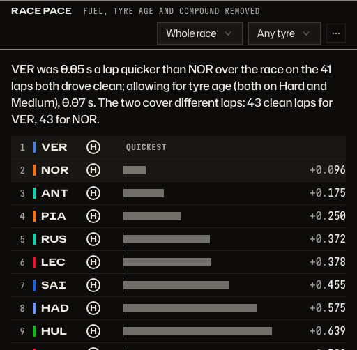

_Pick two drivers and the tile gives the verdict: the gap on the laps both drove clean, then allowing for tyre age. How it is worked out: [pace](../product/pace.md)._

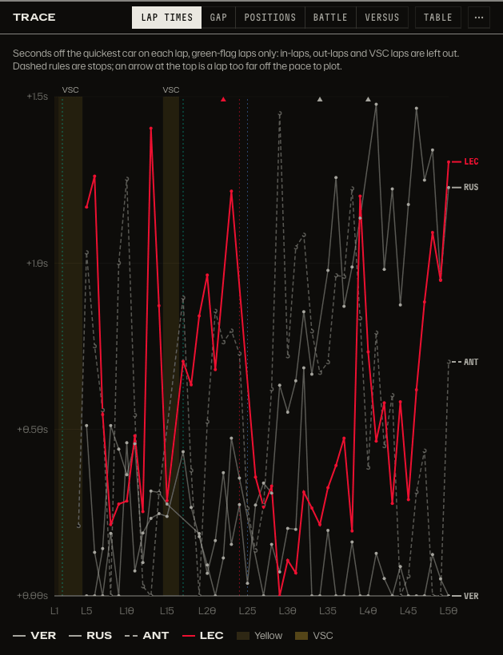

_Lap times: how did each driver's pace move through the race?_

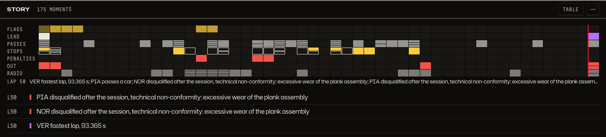

_Race story: what happened, and when?_

## How to get there

- `/strategy?session=9858&plan=pro`: stints, wear, stops and the undercut ledger.
- `/d/battle?session=9858&lap=30&plan=pro`: gaps and Box now.
- `/analysis?session=9858&plan=pro`: race pace and the lap time chart.
- `/d/story?session=9858&plan=pro`: the race story.
- In the bar, use the Strategy, Battle and Analysis tabs, or More, then Race story.

Product doc: [Dashboards and tiles](../product/dashboards.md). How the insights are computed and loaded: [architecture](../architecture.md#4-the-client-routes-dashboards-tiles-insights-ask).

[Back to the tour](README.md)
