# Track and telemetry

Where is everyone on the circuit, who is quick where, and where does one driver gain on another?

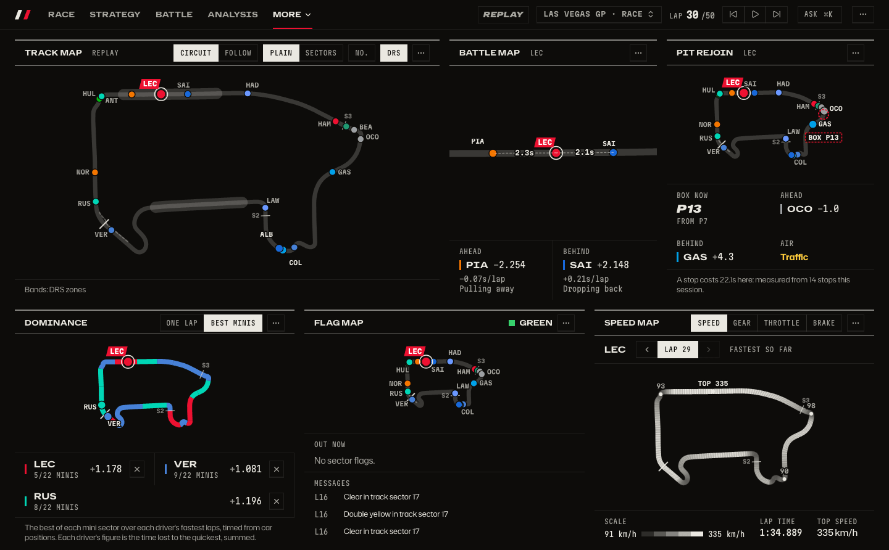

_Where everyone is, who is close, and where the cars are quick._

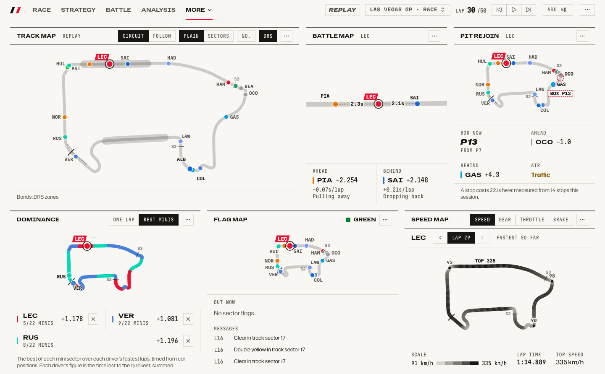

_The same dashboard in the light theme._

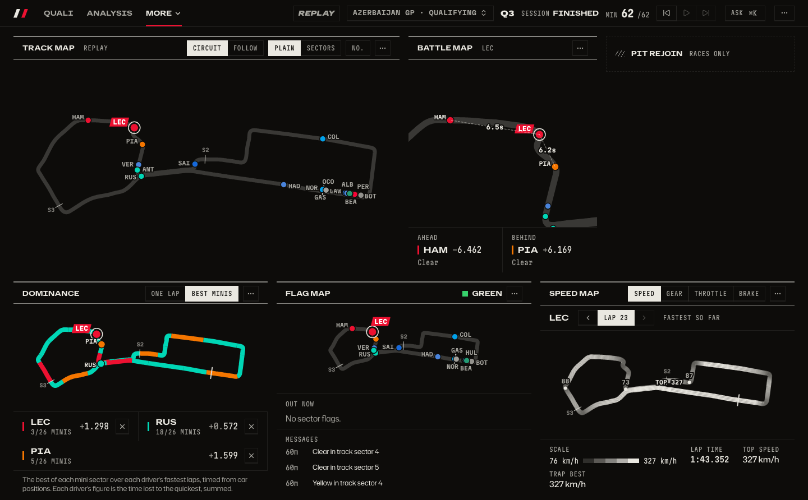

_In qualifying the dashboard follows the laps instead of the race; Pit rejoin folds into a "Races only" strip._

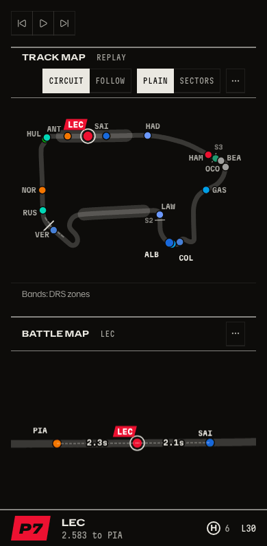

_On a phone the tiles stack into one column._

## The tiles

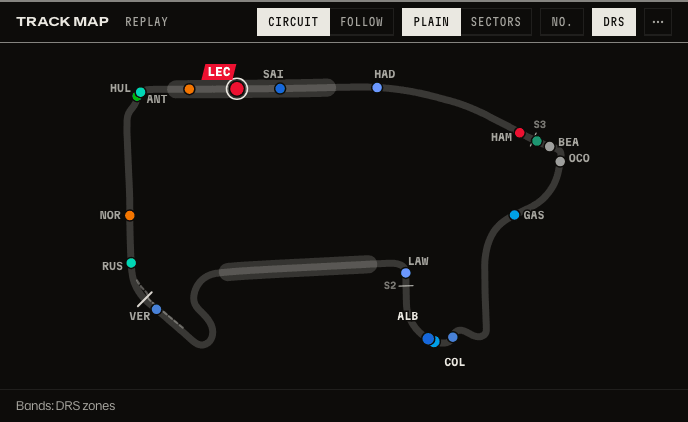

_Track map: where is everyone on the circuit right now?_

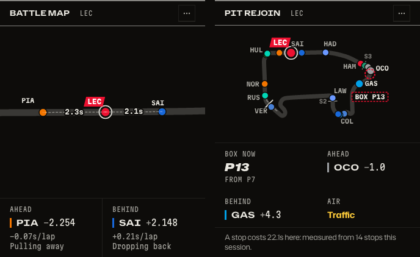

_Battle map and Pit rejoin: how far is my driver from the cars either side, and where would they come out if they boxed now?_

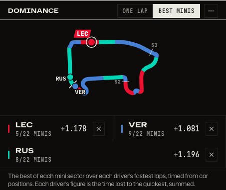

_Mini-sector dominance: who is quickest in each part of the lap?_

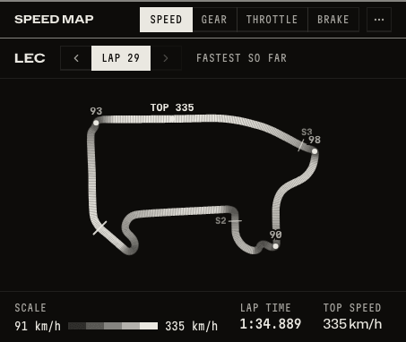

_Speed map: where is the car flat out and where does it slow?_

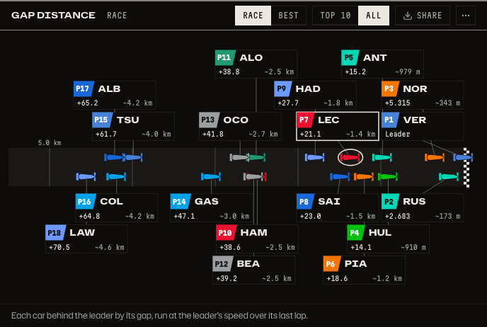

_Gap distance: how far back is that, in metres?_

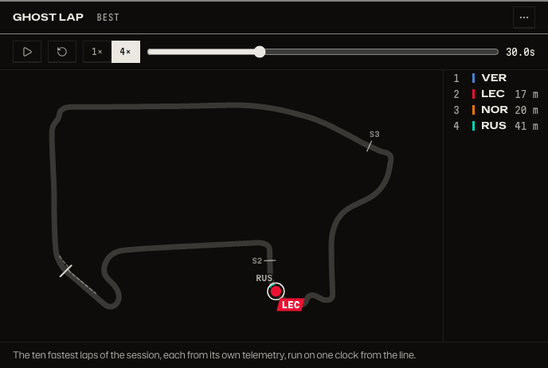

_Ghost lap: where on the lap do the fastest laps gain and lose time?_

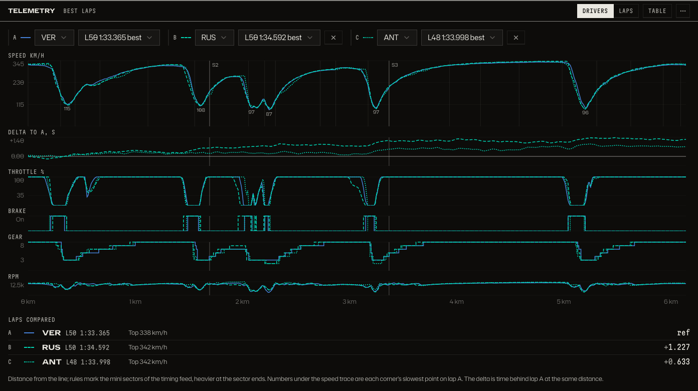

_Telemetry: where on the lap is one driver faster than another?_

## How to get there

- `/d/track?session=9858&lap=30&plan=pro` is the dashboard on the 2025 Las Vegas race at lap 30. In the bar, open More, then Track.
- `/analysis?session=9858&plan=pro` holds the telemetry traces.
- Keys: `←` `→` step a lap, `Shift+←` `Shift+→` jump between events, `Space` plays, `1` to `9` switch dashboards.

Product docs: [Dashboards and tiles](../product/dashboards.md) and [Telemetry](../product/telemetry.md). How the data gets here: [architecture](../architecture.md#4-the-client-routes-dashboards-tiles-insights-ask).

[Back to the tour](README.md)
